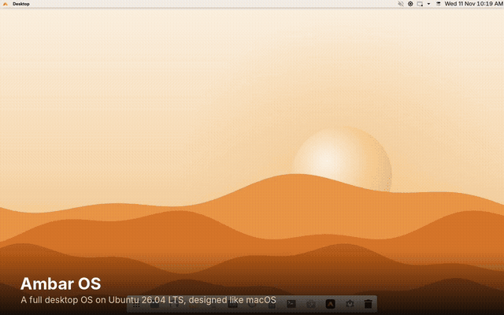

# Ambar OS features

Everything Ambar OS 0.2 includes, with how far each feature has been proven. The marks follow [`docs/STATUS.md`](docs/STATUS.md), which has the detail.

| Mark | Meaning |
|---|---|
| ✅ | seen working: a test or a real run in a virtual machine shows it |
| ⚠️ | built in, but not proven yet (needs real hardware, the internet or a real AI model) |
| 🧪 | experimental |

 ▶ <a href="docs/media/ambar-os-tour.mp4">Watch the 50-second tour</a>. Every frame is a screenshot of the real system.

## 1. A complete operating system

| Feature | Status |
|---|---|
| Ubuntu 26.04 LTS base, Linux 7.0, security updates until 2031 | ✅ built from scratch by `os/ubuntu/build.sh` |
| KDE Plasma 6.6 on Wayland | ✅ live session and installed system start it |
| Live USB: try it without installing | ✅ boots to the full desktop in QEMU |
| UEFI with Secure Boot (Ubuntu's signed shim) and legacy BIOS | ✅ UEFI booted in QEMU · ⚠️ Secure Boot and BIOS not booted yet |
| Ambar boot menu, boot animation, login screen and installer branding | ✅ |
| Safe-graphics and "load into memory" boot options | ✅ in the boot menu · ⚠️ not booted yet |
| Installer: erase disk, install next to Windows, manual partitioning, disk encryption | ✅ full install with Erase disk (43/43 steps) · ⚠️ the other modes not run yet |
| The installed system boots on its own and logs in | ✅ login screen, password login, Ambar service · ⚠️ desktop not yet drawn under slow emulation, see STATUS |
| Identifies as "Ambar OS 0.2 (based on Ubuntu 26.04.1 LTS)", still compatible with Ubuntu software and PPAs | ✅ |
| System snapshots and restore (Timeshift), firewall, firmware updates, Driver Manager | ✅ installed · ⚠️ not exercised |

## 2. Designed like macOS

| Feature | What it does | Status |
|---|---|---|
| Menu bar | Ambar menu, the active app's name, the app's own menus, status icons, Control Center, clock | ✅ |
| Ambar menu | About This Computer, System Settings, Ambar Store, Automations, Force Quit, Sleep, Restart, Shut Down, Lock Screen, Log Out | ✅ |
| Global app menus | Files, Terminal and other apps show their menus in the menu bar | ✅ seen with Files |
| Control Center | macOS-style modules: Wi-Fi, Bluetooth, Airplane mode, Do Not Disturb, dark mode, Night Light, Display and Sound sliders, screenshot | ✅ reads real Wi-Fi, volume and brightness in the VM · ⚠️ Bluetooth and Wi-Fi switching need hardware |
| Dock | Floating, rounded and frosted, centred, with pinned apps, soft highlights for running apps, and Trash | ✅ |
| Launchpad | Ambar's own: every app on full-screen pages over the blurred desktop, page dots, type to search, Enter to open | ✅ seen in the built desktop |
| Spotlight-style search | Meta+Space or Alt+Space finds apps, files, settings and automations | ✅ |
| Mission Control | All windows at a glance (Meta+W or the top-left screen corner) | ✅ |
| Window buttons | Red, yellow and green traffic lights on the left | ✅ |
| Light and dark | One switch changes colours, panels, icons and window frames | ✅ |
| App icons | Every installed app's icon on the same squircle tile, like macOS, in light and dark; amber folders; apps installed later (APT or Flatpak) get tiles too | ✅ seen in the Dock, Launchpad and Files |
| Ambar Plasma Style | Translucent menu bar; rounded popups, menus and tooltips with soft shadows; one style for light and dark | ✅ seen in the built desktop · ⚠ blur needs a real GPU |
| Terminal | Ambar colours (readable in every colour), JetBrains Mono, roomy margins | ✅ |
| Sounds | Ambar's own sound theme: soft, quiet chimes for login, messages, errors and more (made for Ambar) | ✅ files and levels checked · ⚠️ not heard here (no audio) |
| Start-up screen | Ambar logo and progress line instead of KDE's | ✅ renders · ⚠ not yet seen at a real boot |
| Crisp, consistent text | Inter everywhere, greyscale antialiasing with slight hinting (like macOS); GTK apps (Firefox, GIMP…) use the same font, icons and left-hand window buttons | ✅ font settings checked · ⚠️ not yet seen in a booted image |
| Touchpad gestures | Plasma's three- and four-finger gestures | ⚠️ needs a touchpad |

## 3. Apps out of the box

| Area | Apps | Status |
|---|---|---|
| Web | Firefox (release builds) or Falkon | ✅ Falkon here · ⚠️ Firefox only in CI builds |
| Files and system | Files (Dolphin), Terminal (Konsole), System Settings, System Monitor, Disk Usage, Find, Ark | ✅ in the image; 27 key apps are checked at every boot test |
| Office | LibreOffice Writer, Calc, Impress; Okular (PDF) | ✅ |
| Mail, calendar, contacts, reminders | KMail, Merkuro Calendar and Contacts (with tasks), KOrganizer, Kontact | ✅ |
| Notes | Marknote | ✅ installed in the built desktop |
| Media | Elisa (music), Haruna and VLC (video), Gwenview (photos), Spectacle (screenshots), Kamoso (camera), Skanpage (scanner), Recorder | ✅ |
| Creative | GIMP and Krita (photos, painting), Inkscape (design), Kdenlive (video editing), OBS Studio (recording, streaming) | ✅ installed in the built desktop |
| Everyday | Weather, Marble (maps), Clock, Font Manager, Kup (backups of your files) | ✅ installed in the built desktop |
| Games | Patience, Mines, Sudoku, Mahjongg, Blocks, Diamond | ✅ installed in the built desktop |
| Tools | Kate, KCalc, KDE Connect (phone link), Colour Picker, Sweeper | ✅ |
| Recommended apps | First-login picks from Flathub: Chrome, VS Code, Spotify, Zoom, Slack, Discord, Telegram, Signal, Thunderbird, Steam, Blender, Bitwarden | ✅ the picker is tested · ⚠️ the downloads need internet, not run here |
| Input | fcitx5 for Indian and other non-Latin scripts | ✅ installed |

## 4. Install anything

| Source | How | Status |
|---|---|---|
| Ambar Store | Ubuntu apps, Flathub and Snap in one place, plus updates | ✅ opens · ⚠️ Flathub needs internet on first boot |
| `.deb` from any website | Double-click (Chrome, VS Code, Zoom, Steam, …) | ✅ opens in the Store |
| Flatpak | Flathub set up on first boot | ⚠️ needs internet |
| Snap | `snapd` included | ✅ installed |
| AppImage | Download, make executable, run | ✅ supported |
| Windows apps | Double-click a `.exe` or `.msi` to run it with Wine | ✅ file handler set · ⚠️ app compatibility varies |
| Other Linux distros | distrobox + podman containers | ✅ installed |
| Codecs and drivers | Media codecs; Driver Manager for NVIDIA and others | ✅ codecs installed · ⚠️ drivers need hardware |

## 5. Ambar automations (the extra layer)

| Feature | Status |
|---|---|
| Automations from short TOML files: schedule, folder-watch and manual triggers; conditions; actions to create folders, copy, move, write or trash files and send notifications | ✅ 131 Rust tests, ~30,000 property cases |
| Safe by design: can never run a program or command; limited to granted folders; trash and overwrite wait for your approval; everything in an audit log | ✅ attack and sabotage tests |
| `ambard` background service, starts at login, runs as you (never root) | ✅ running in the live and installed systems |
| Automation Center app, light and dark, with live approvals | ✅ |
| AI drafts automations from plain English (Claude, OpenAI-compatible, Ollama), with a risk review before anything is added | ✅ against mock APIs · ⚠️ never run against a real model |
| Agents: assistants with limited scopes that can propose but never approve | ✅ |
| Signed packages and a marketplace of starter automations | ✅ |
| First-run Welcome: appearance, optional AI, starter automations | ✅ |
| `ambar` CLI and Python SDK | ✅ |

## 6. Security tools (Kali's tool set, modernised)

Details: [Security tools](docs/security.md).

| Feature | Status |
|---|---|
| Every tool in Kali's default ISO covered (204 packages: each one installed or left out with a written reason), in Kali's tiers and 13 menu categories | ✅ coverage checked by a test |
| `ambar-sec` command and the **Ambar Security** app (Ambar's kali-tweaks): install a tier, a category or single tools | ✅ tested with stand-in tools; the app tested offscreen |
| ~150 tools from Ubuntu 26.04 packages, updated with the system | ✅ all 151 packages installed together in a clean 26.04 system |
| Network services from the set (Apache, MySQL, Samba, SNMP, the SSH server sslh pulls in…) installed but left off; ones you enabled yourself are kept | ✅ seen in that install, and tested |
| Python tools in isolated environments: NetExec, Certipy, Impacket, BloodHound CE, enum4linux-ng, theHarvester, sslyze, Volatility 3… | ✅ all 10 installed and run on Ubuntu 26.04 (Python 3.14) |
| Release binaries (nuclei, httpx, subfinder, naabu, katana, dnsx, trufflehog, chisel), installed only if the published SHA-256 matches | ✅ checksum check, tampered and unsigned releases tested · ⚠️ real download needs the GitHub build |
| Kali rolling container for Metasploit, Burp Suite, Responder, WPScan and the Large/Everything tiers | ✅ commands tested with stand-ins · ⚠️ container download not run here |
| Modern replacements: NetExec, enum4linux-ng, ffuf/feroxbuster, subfinder, Name-That-Hash, Volatility 3, nuclei, naabu | ✅ in the catalogue |
| Launchpad Security folder with Kali's categories | ✅ menu files validated · ⚠️ not yet seen in a booted desktop |
| **Ambar OS Security** ISO (Default tier preinstalled) | ⚠️ recipe and CI build written; built and boot-tested by the GitHub workflow |

## 7. Ambar's own tools

Details: [Ambar's own tools](docs/ambar-tools.md).

| Tool | What it does | Status |
|---|---|---|
| **Ambar Recon** (`ambar-recon`, Rust) | Ports and service banners, HTTP fingerprint and missing security headers, TLS and certificate trust, subdomains from CT logs and DNS; JSON output | ✅ 20 tests against real local servers, including a real TLS certificate chain |
| **Engagement scope**, shared by every Ambar security tool | Include/exclude networks, hosts and `*.domains`, engagement dates, resolved addresses and redirects checked, activity log | ✅ unit and end-to-end tests; out-of-scope and excluded targets refused |
| **Ambar Workbench** (`ambar-engage` + app) | Engagements, scoped runs of Recon/nmap/nuclei/…, automatic findings with severities, Markdown/HTML/PDF report | ✅ full flow tested with real scans and a real PDF |
| **OWASP testing checklist** in Workbench | All 109 tests of the OWASP Web Security Testing Guide per engagement: status, notes, findings linked to tests, coverage in the report | ✅ tested, including the app page |
| **Practice labs** (`ambar-lab`) | OWASP Juice Shop and WebGoat in containers on 127.0.0.1 only | ✅ commands tested with a stand-in Podman · ⚠️ image download needs internet, not run here |
| **OWASP Dependency-Check** (`ambar-depcheck`) | Known vulnerabilities in your own project's libraries; project mounted read-only | ✅ command tested with a stand-in Podman · ⚠️ real scan needs internet, not run here |
| **Ambar Guard** (`ambar-guard` + app) | 11 security checks with a score, one-click fixes, live per-app network connections from `/proc` | ✅ tested on a fake system and run on a real one |
| **Ambar Clean** (`ambar-clean` + app) | Safe disk clean-up with sizes; Trash only on request | ✅ tested, including symlinks that must not be followed |
| **Ambar Share** (`ambar-share` + app) | Send files on the local network with an unguessable link and QR code, time limit, one-time option | ✅ tested: wrong links, expiry, one-time |
| One design for all of them | Sidebar, page titles, cards, badges and the Inter font of the Automation Center; light and dark; every colour pair passes WCAG AA | ✅ contrast tested; every app rendered in both themes |
| All of the above in Launchpad and the ISO | | ✅ in the build recipe and boot test · ⚠️ not yet seen in a booted image |

## 8. For developers and testers

| Feature | Status |
|---|---|
| One-command ISO build: `sudo os/ubuntu/build.sh all` | ✅ |
| Automatic boot test in QEMU over the serial console, with screenshots | ✅ |
| CI builds and boots the ISO on every change (`.github/workflows/os-ubuntu.yml`) | ⚠️ written, runs once the repo is on GitHub |
| `ambar-hwreport` for hardware reports, with no serial numbers or addresses | ✅ |
| `AGENTS.md` and `.cursor/rules/` for AI editors | ✅ |
| Atomic edition: Fedora Kinoite + bootc, image updates and rollback, ARM64, Raspberry Pi | 🧪 recipe written, built only in CI |
