<p align="center">
  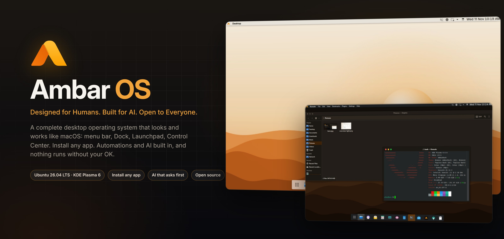
</p>

<p align="center">
  <a href="https://github.com/alexbieber/AmbarOS/actions/workflows/ci.yml"></a>
  <a href="https://github.com/alexbieber/AmbarOS/actions/workflows/os-ubuntu.yml"></a>
  <a href="https://alexbieber.github.io/AmbarOS/"></a>
  <a href="LICENSE"></a>
  
  
</p>

<p align="center">
  <b><a href="https://alexbieber.github.io/AmbarOS/">Documentation</a></b> ·
  <a href="docs/live-usb.md">Try it from a USB stick</a> ·
  <a href="docs/install.md">Install</a> ·
  <a href="docs/first-steps.md">First steps</a> ·
  <a href="docs/hardware.md">Hardware</a> ·
  <a href="docs/STATUS.md">Status</a> ·
  <a href="FEATURES.md">Features</a>
</p>

---

**Ambar OS** is a complete desktop operating system that looks and works like macOS. It has a menu bar with the Ambar menu and each app's menus, a Dock, Launchpad, Control Center, Spotlight-style search, Mission Control, and red, yellow and green window buttons. It comes with everything you need on day one:

- a browser
- Files
- Terminal
- an office suite
- mail, calendar, contacts, notes and reminders
- music, video and photos, and a player for every format (VLC)
- photo editing (GIMP, Krita), design (Inkscape), video editing (Kdenlive), recording and streaming (OBS)
- weather, maps, clock, voice recorder, fonts, backup and a few games
- System Settings
- an App Store, plus one-click picks of Chrome, VS Code, Spotify, Zoom, Steam and more on first login

It installs **any app**: the Ambar Store, `.deb` downloads, Flatpak, Snap, AppImage, and Windows programs through Wine.

For security work there's **Ambar OS Security**: Kali Linux's whole tool set, organised the Kali way, but from modern sources. Ubuntu packages, isolated Python tools, checksum-verified release binaries, and an isolated Kali container for the rest. See [Security tools](docs/security.md).

Under the hood it's **Ubuntu 26.04 LTS** with **KDE Plasma 6**, so it gets five years of security updates and Ubuntu's hardware support. On top of that, Ambar adds an **automation layer**: background automations, and an AI assistant that drafts new ones. Nothing runs without your OK.

<p align="center">
  <a href="docs/media/ambar-os-tour.mp4">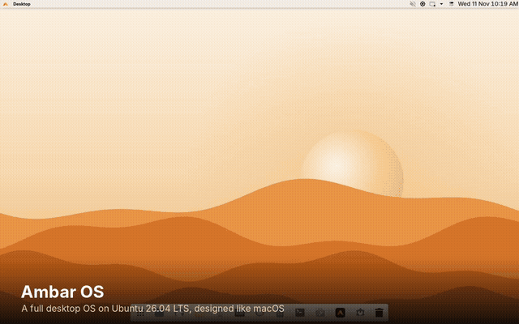</a><br>
  <sub>▶ <a href="docs/media/ambar-os-tour.mp4"><b>Watch the 50-second tour (MP4)</b></a>. Every frame is a screenshot of the real system. · <a href="FEATURES.md"><b>Full feature list</b></a></sub>
</p>

<table>
<tr>
<td width="50%"><br><sub><b>Launchpad</b>: every app A–Z, favourites, categories and search</sub></td>
<td width="50%">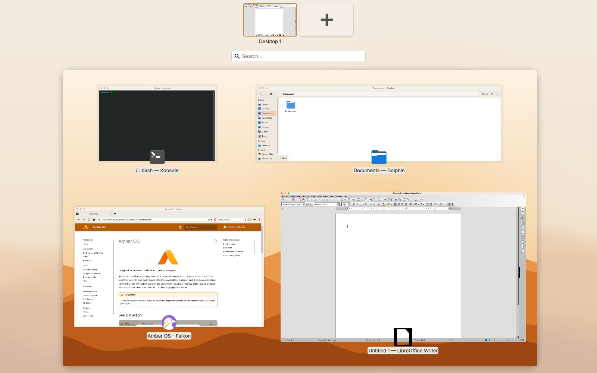<br><sub><b>Mission Control</b> (Meta+W): every open window and desktop at a glance</sub></td>
</tr>
<tr>
<td><br><sub><b>Ambar menu</b>: About This Computer, Settings, Store, Force Quit, Sleep, Restart, Shut Down</sub></td>
<td><br><sub><b>Control Center</b>: Wi-Fi, Bluetooth, Do Not Disturb, Dark Mode, Night Light, display and sound</sub></td>
</tr>
<tr>
<td>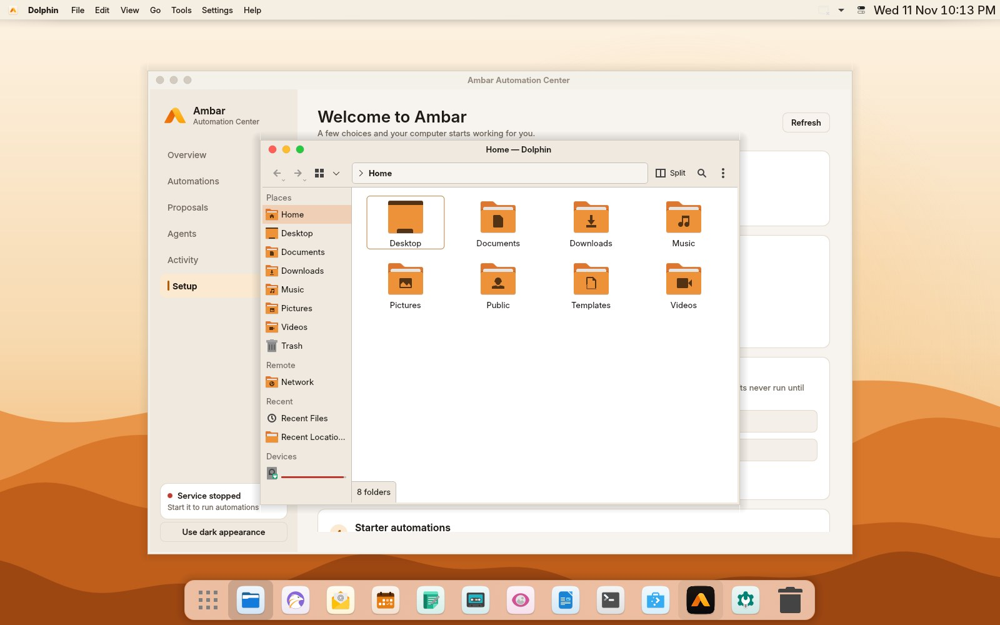<br><sub><b>Files</b> with the app's menus in the menu bar, like macOS</sub></td>
<td>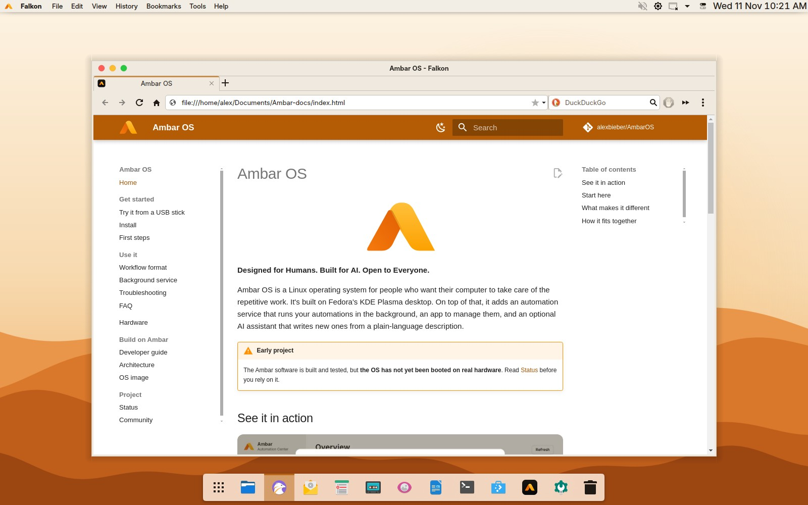<br><sub><b>Browser</b>: Firefox in release builds, Falkon in local builds</sub></td>
</tr>
<tr>
<td>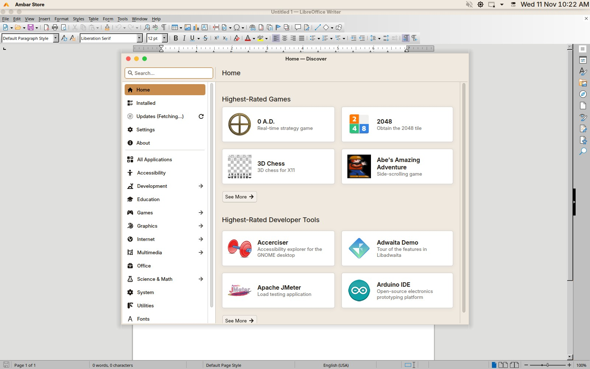<br><sub><b>Ambar Store</b>: Ubuntu apps, Flathub and Snap in one place</sub></td>
<td>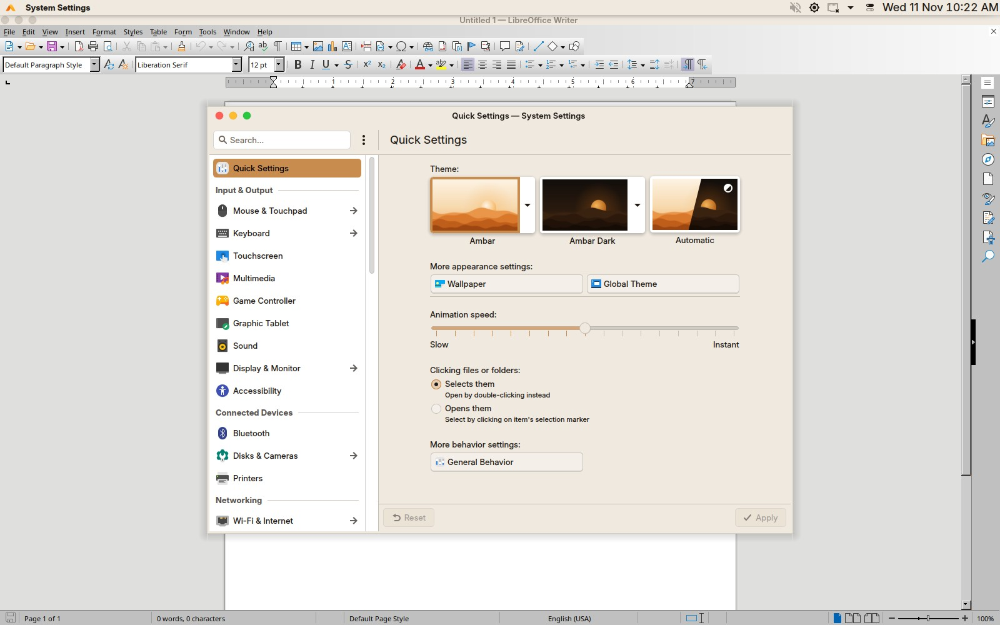<br><sub><b>System Settings</b>: Wi-Fi, Bluetooth, displays, sound, users, printers, languages and more</sub></td>
</tr>
<tr>
<td colspan="2">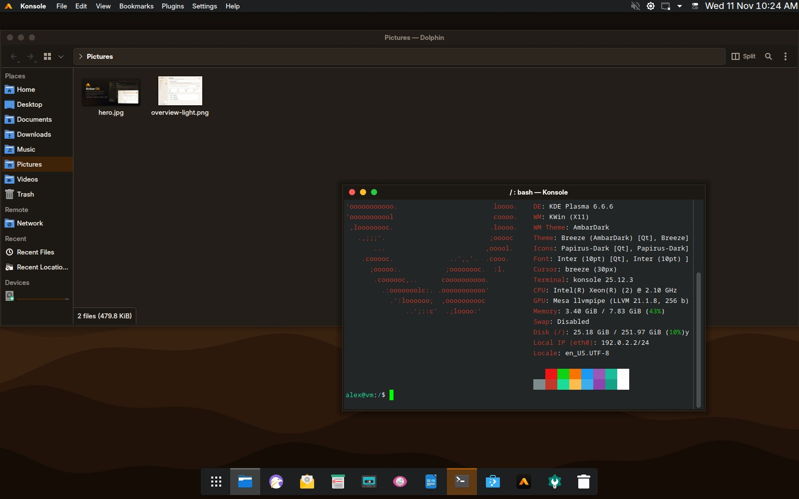<br><sub><b>Dark Mode</b> switches the whole desktop: colours, icons, window frames and wallpaper</sub></td>
</tr>
</table>

<sub>Screenshots of the real Ambar OS desktop, taken from the built system by <code>os/ubuntu/desktop-shots.sh</code>.</sub>

> [!IMPORTANT]
> **Early project, real OS.** The ISO is built from scratch and **boots in a virtual machine to the full Ambar desktop** (Plasma 6 on Wayland). The installer completes a full install, and the installed system boots to its own login screen. **It hasn't been tried on a physical PC yet**, and the installed desktop still needs testing on faster hardware than this emulator. [Status](docs/STATUS.md) lists exactly what is and isn't proven, including the bugs that booting it turned up.

<table>
<tr>
<td width="50%">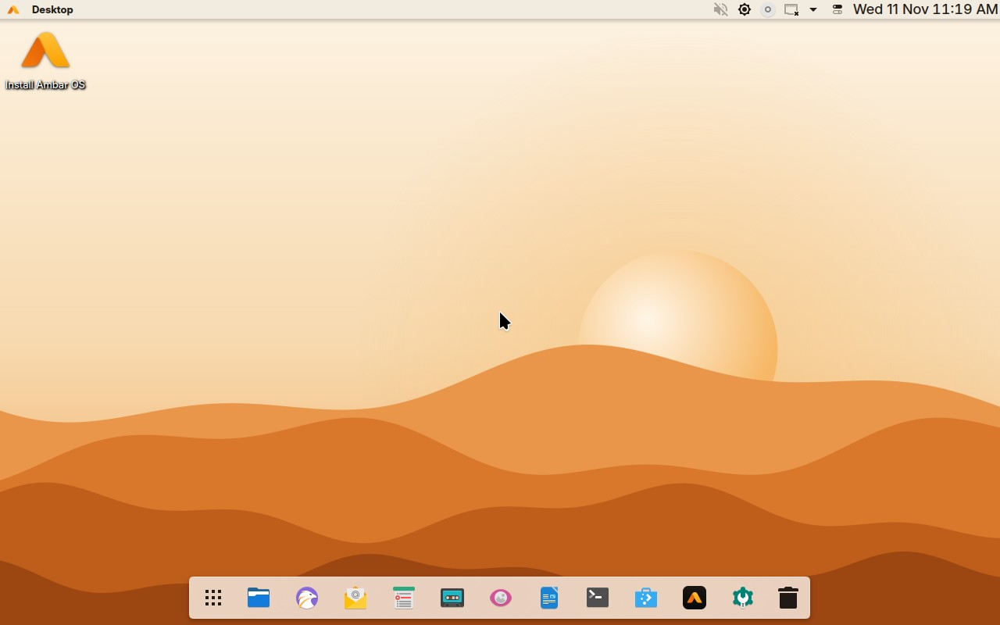<br><sub>The ISO booted in QEMU: Ambar desktop, Dock and menu bar</sub></td>
<td width="50%">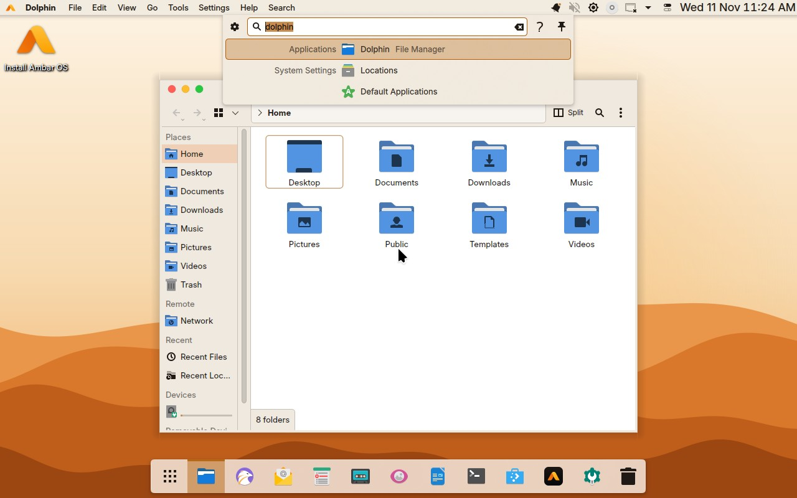<br><sub>Same boot: search opened Files, whose menus sit in the menu bar</sub></td>
</tr>
<tr>
<td width="50%">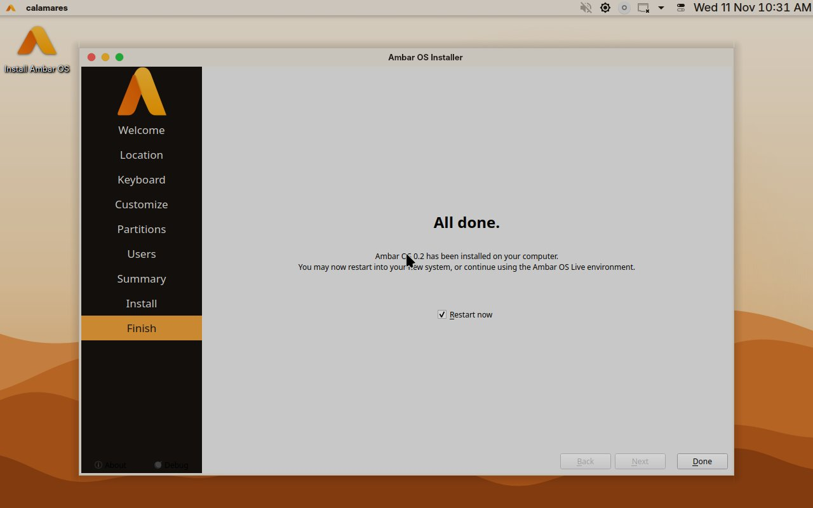<br><sub>A full install onto a blank 40 GB disk, all 43 steps</sub></td>
<td width="50%">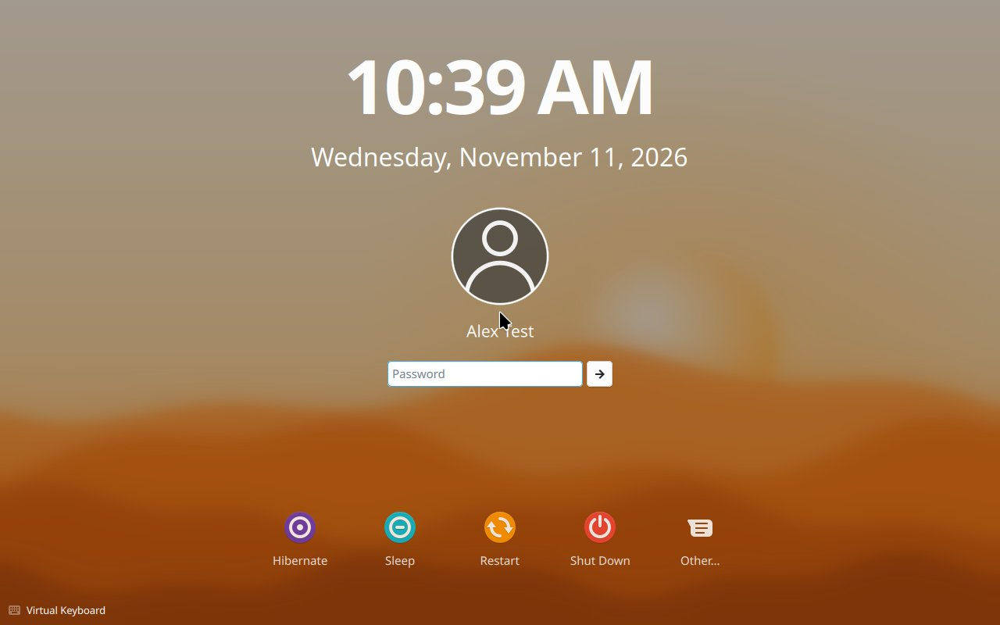<br><sub>The installed system booting on its own, at its login screen</sub></td>
</tr>
</table>

## Why Ambar

<table>
<tr>
<td width="33%" valign="top">

### 🍎 Feels like a Mac
Menu bar with app menus, Dock, Launchpad, Control Center, Spotlight (Meta+Space), Mission Control and traffic-light window buttons. Light and dark, with the Ambar look throughout: login screen, boot animation and installer.

</td>
<td width="33%" valign="top">

### 📦 Installs anything
The **Ambar Store** brings together Ubuntu's apps, Flathub and Snap. You can also double-click a `.deb` from any website (Chrome, VS Code, Zoom, Steam…), run AppImages, and open Windows `.exe` files with Wine. Driver Manager handles NVIDIA and other drivers.

</td>
<td width="33%" valign="top">

### 🧡 Automations you can trust
An automation can only use the built-in actions:

- create folders
- copy, move, write or trash files
- send notifications

Each automation is limited to the folders it declares. It can **never run a program or command**. You approve its access first, and everything it does goes into an audit log.

</td>
</td>
</tr>
</table>

## Ambar automation

The extra layer: automations that run in the background, an AI assistant that drafts new ones, and nothing runs without your OK.

<p align="center">
  <a href="docs/media/ambar-demo.mp4">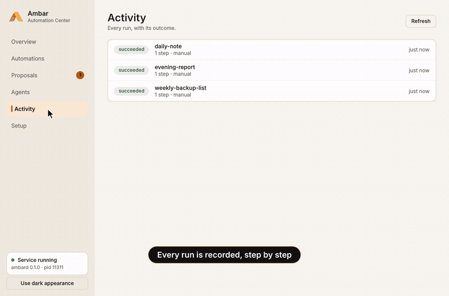</a><br>
  <sub>▶ <a href="docs/media/ambar-demo.mp4"><b>Watch the full 1-minute demo (MP4)</b></a>. This is a recording of the real Automation Center and service. The AI reply is replayed from a file, so it needs no API key.</sub>
</p>

### Automation Center

<table>
<tr>
<td width="50%">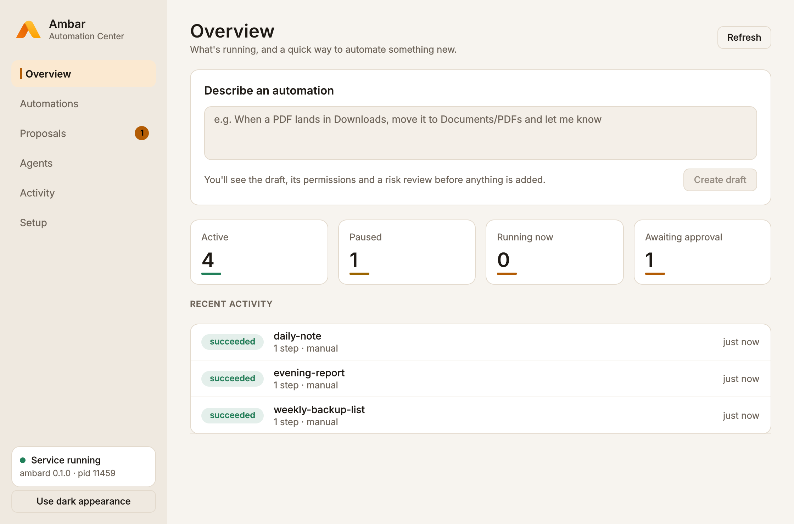<br><sub><b>Overview</b>: what's running, plus a box to describe a new automation</sub></td>
<td width="50%">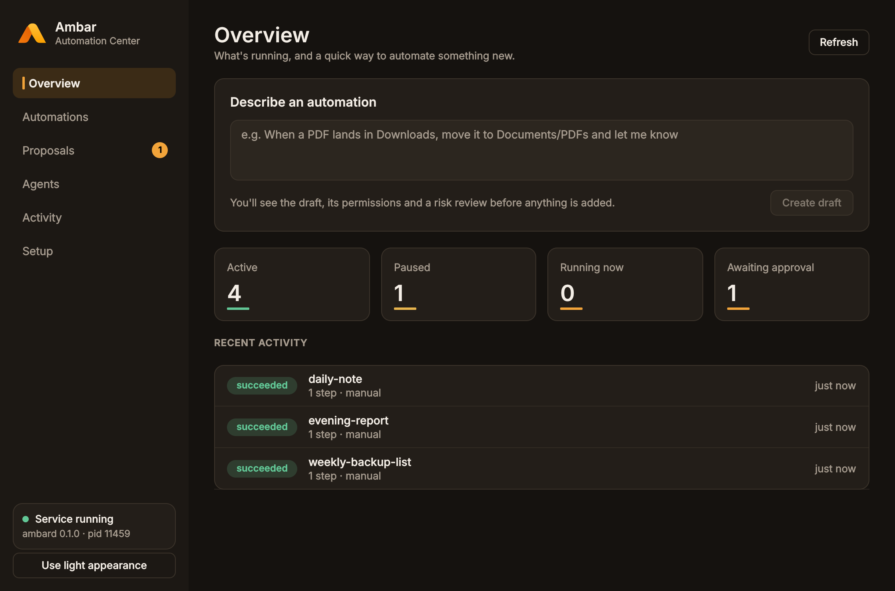<br><sub><b>Light and dark</b>, matched to the whole Plasma desktop</sub></td>
</tr>
<tr>
<td>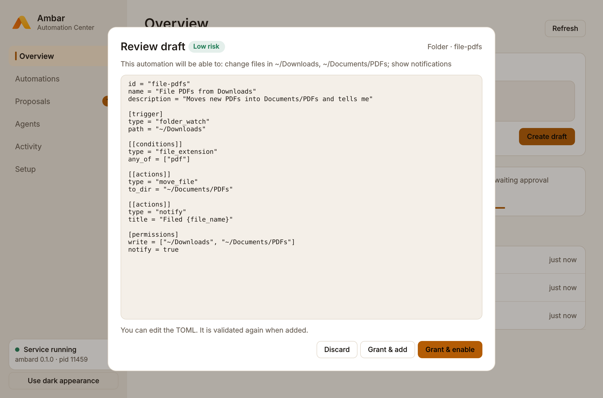<br><sub><b>AI draft review</b>: the automation, the access it needs and a risk level, before anything is added</sub></td>
<td>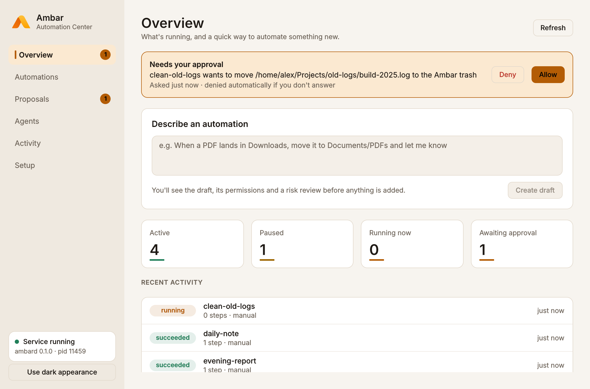<br><sub><b>Live approval</b>: sensitive actions like trash wait for you, and are denied if you don't answer</sub></td>
</tr>
<tr>
<td>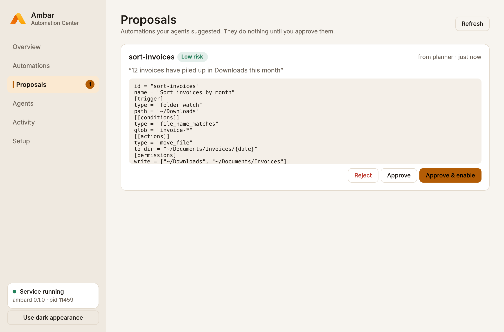<br><sub><b>Agents propose, you decide</b>: assistants have limited scopes and can't approve anything</sub></td>
<td>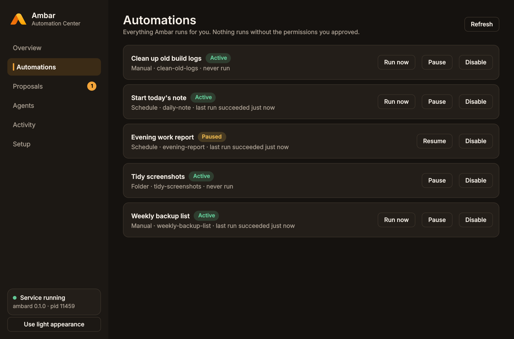<br><sub><b>Automations</b>: run, pause, resume or disable, each with its last result</sub></td>
</tr>
<tr>
<td>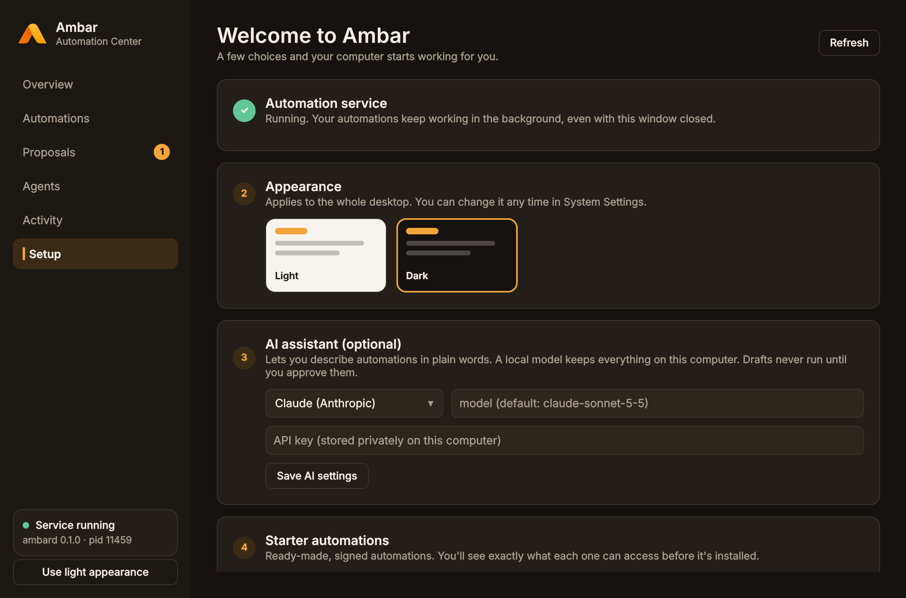<br><sub><b>First-run Welcome</b>: service, appearance, optional AI and signed starter automations</sub></td>
<td>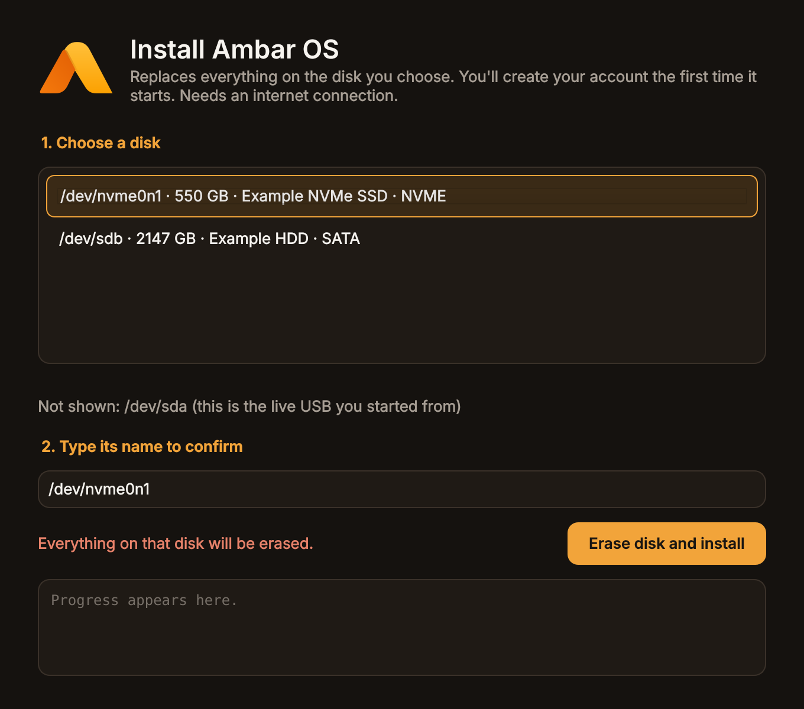<br><sub><b>Live USB installer</b>: only offers safe disks, and you type the disk name to confirm (shown with example disks)</sub></td>
</tr>
</table>

<sub>All screenshots are of the real software, generated by <code>scripts/demo/screenshots.py</code> against a running <code>ambard</code>.</sub>

## What's inside

| | |
|---|---|
| 🧠 **Automation engine** | Triggers (manual, schedule, folder watch), conditions, a closed set of actions, history and an audit log |
| ⚙️ **`ambard` service** | Runs as you, never as root, and is reached through a private local socket with a token. It handles live approvals and restores your automations at login |
| ✨ **AI builder** | Claude, OpenAI-compatible or Ollama. Writes drafts with a risk review. A model that insists on running commands never gets a draft through |
| 🤖 **Agents** | Assistants with their own identity and limited scopes (read, propose, memory, run). They're rate-limited and can be revoked instantly |
| 📦 **Packages and marketplace** | ed25519-signed workflow bundles, an explicit publisher trust store, and a bundled marketplace |
| 💿 **The OS** | Ubuntu 26.04 LTS, Linux 7.0, KDE Plasma 6.6 on Wayland. Live/installer ISO for UEFI (Secure Boot) and BIOS, with the Calamares installer (erase disk, install alongside Windows, encryption) |
| 🍎 **macOS-style shell** | Menu bar with the Ambar menu, app name and global app menus, Control Center, floating Dock, Launchpad, Spotlight search, Mission Control, Aurorae traffic-light decorations, light/dark themes |
| 🗂️ **Apps** | Browser, Files, Terminal, LibreOffice, KMail, KOrganizer, Okular, Gwenview, Elisa, Haruna, Kate, Spectacle, Ark, KCalc, KDE Connect, System Monitor, Timeshift |
| 🛍️ **Install anything** | Ambar Store (apt, Flathub, Snap), `.deb` double-click, AppImage, Wine, distrobox/podman, codecs, Driver Manager |
| 🖥️ **Ambar apps** | Automation Center (Qt/QML), Meta+Space search for automations, first-run Welcome, the Ambar logo and theme |
| 🛡️ **Security tools** | Kali's default set (204 packages covered) in Kali's tiers and categories, with modern replacements (NetExec, nuclei, ffuf, subfinder, enum4linux-ng…), the `ambar-sec` command, the Ambar Security app and a Security edition ISO |
| 🧰 **Ambar's own tools** | **Recon** (Rust scanner), **Workbench** (scope → scans → findings → PDF report), **Guard** (security score, fixes, live connections), **Clean** and **Share**, all scope-aware where it matters ([details](docs/ambar-tools.md)) |
| 🔧 **Tools** | `ambar` CLI, Python SDK, `ambar-hwreport` for hardware reports |

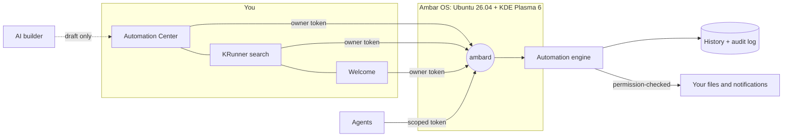

## Get it

| | |
|---|---|
| **Try it without installing** | Write the ISO to a USB stick and start from it → [guide](docs/live-usb.md) |
| **Install** | From the USB stick: erase the disk, or install next to Windows → [guide](docs/install.md) |
| **Virtual machine** | VirtualBox, VMware, GNOME Boxes, Hyper-V → [guide](docs/install.md#virtual-machine) |
| **Build it** | `sudo os/ubuntu/build.sh all` → `output/ubuntu/ambar-os-0.2-amd64.iso` → [guide](docs/os-image.md) |

The ISO is built and boot-tested by the **Ambar OS ISO** workflow. Until the first release, download it from the latest run's artifacts.

## Quick start

Run the Ambar software on an existing Linux machine. Requires Rust 1.89+ and Python 3.11+.

```sh
cargo build --release && export PATH="$PWD/target/release:$PATH"

ambar service start                                   # the background service
ambar workflow add examples/organize-downloads.toml --enable
ambar workflow list
ambar history --steps

ambar ai config --provider ollama                     # or anthropic / openai
ambar ai create "when a PDF lands in Downloads, move it to Documents/PDFs and tell me"

pip install ./sdk/python ./desktop/automation-center && ambar-center
```

An automation is a short TOML file:

```toml
id = "organize-downloads"
name = "Organize downloads"

[trigger]
type = "folder_watch"
path = "~/Downloads"

[[conditions]]
type = "file_extension"
any_of = ["pdf", "png", "jpg"]

[[actions]]
type = "move_file"
to_dir = "~/Documents/Ambar Inbox/{file_ext}/{date}"

[[actions]]
type = "notify"
title = "Filed {file_name}"

[permissions]
write = ["~/Downloads", "~/Documents/Ambar Inbox"]
notify = true
```

More: [First steps](docs/first-steps.md) · [Workflow format](docs/workflow-format.md) · [Developer guide](docs/developer-guide.md) · [Service](docs/service.md)

## Security model

- **No execution.** Workflows, packages and AI output can't run programs or shell commands. The action set is closed.
- **Grants first.** Nothing runs until you approve the workflow's declared access. Grants are re-read on every run, so revoking one works immediately.
- **Paths re-checked.** Every path is resolved and checked at run time, so symlinks and `..` can't escape a grant.
- **Sensitive means asked.** Trash and overwrite need your approval. Trash can be undone; nothing is permanently deleted.
- **Everything audited.** Every grant, change and refusal is logged.
- **Scoped agents.** An agent with every scope still can't grant, enable or approve anything.

Details: [Architecture](docs/architecture.md) · [Security policy](SECURITY.md) · [Known gaps](docs/STATUS.md#known-gaps-by-design-or-deferred)

## Project status

| | |
|---|---|
| ✅ Proven | The ISO builds here, boots to the Ambar desktop in QEMU and runs the installer. The macOS-style shell, apps and install-anything tools work. The Ambar automation software is fully tested (Rust, Python and desktop tests). |
| ⚠️ Not yet proven | Physical hardware, Firefox in a local build (CI adds it), Flathub on first boot, a real AI model, touchpad gestures |
| 🧪 Experimental | The atomic edition (Fedora Kinoite + bootc, ARM64, Raspberry Pi) in `os/` |

[Full status →](docs/STATUS.md)

## Development

- **Features, with what's proven:** [FEATURES.md](FEATURES.md) · **Tour video:** [ambar-os-tour.mp4](docs/media/ambar-os-tour.mp4)
- **Working with an AI editor (Cursor, Claude Code):** it reads [AGENTS.md](AGENTS.md) and `.cursor/rules/` automatically.
- **Putting it on GitHub and publishing the ISO:** [Publish on GitHub](docs/github-setup.md), or in Cursor just say *"Follow CURSOR.md"* ([CURSOR.md](CURSOR.md))

```sh
bash scripts/verify.sh            # everything CI checks, plus a live ambard smoke test
```

| Area | Path |
|---|---|
| The OS | `os/ubuntu/` (build.sh, packages, hooks, branding, boot test) |
| macOS-style shell | `desktop/plasma/` (layout, widgets, Control Center, window decorations, themes) |
| Rust crates | `crates/` (`ambar-automation`, `ambar-service`, `ambar-ai`, `ambar-pkg`, `ambar-cli`) |
| Desktop | `desktop/` (Automation Center, KRunner, Plasma theme, brand) |
| Atomic edition (experimental) | `os/` (Containerfile, live USB, Raspberry Pi) |
| Docs site | `docs/` + `mkdocs.yml` |
| Demo video and screenshots | `scripts/demo/` (`record_demo.py`, `screenshots.py`, `hero.py`) |

CI: [`ci.yml`](.github/workflows/ci.yml) covers Rust on Linux and macOS, the MSRV check, `cargo audit`, and the Python, desktop, OS-recipe and docs tests. [`os-ubuntu.yml`](.github/workflows/os-ubuntu.yml) builds and boot-tests the Ambar OS ISO. [`os-image.yml`](.github/workflows/os-image.yml) builds the experimental atomic edition. [`docs.yml`](.github/workflows/docs.yml) publishes the site.

## Contributing

Hardware reports, docs fixes and bug reports are as welcome as code. Start with [CONTRIBUTING.md](CONTRIBUTING.md) and the [Code of Conduct](CODE_OF_CONDUCT.md). If you have five minutes, boot the live USB, run `ambar-hwreport`, and [send a hardware report](docs/hardware.md#report-your-computer).

## License

[Apache-2.0](LICENSE). Ambar OS is built on Ubuntu and KDE Plasma, and is not affiliated with or endorsed by Canonical or KDE. The full vision is in the [master plan](docs/MASTER_PLAN.md).
