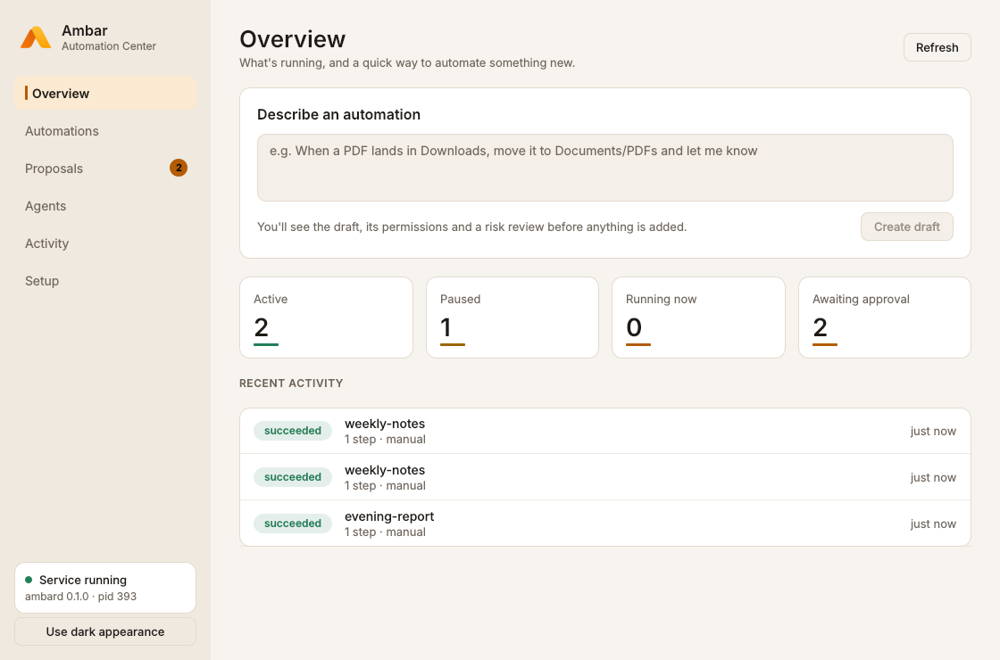
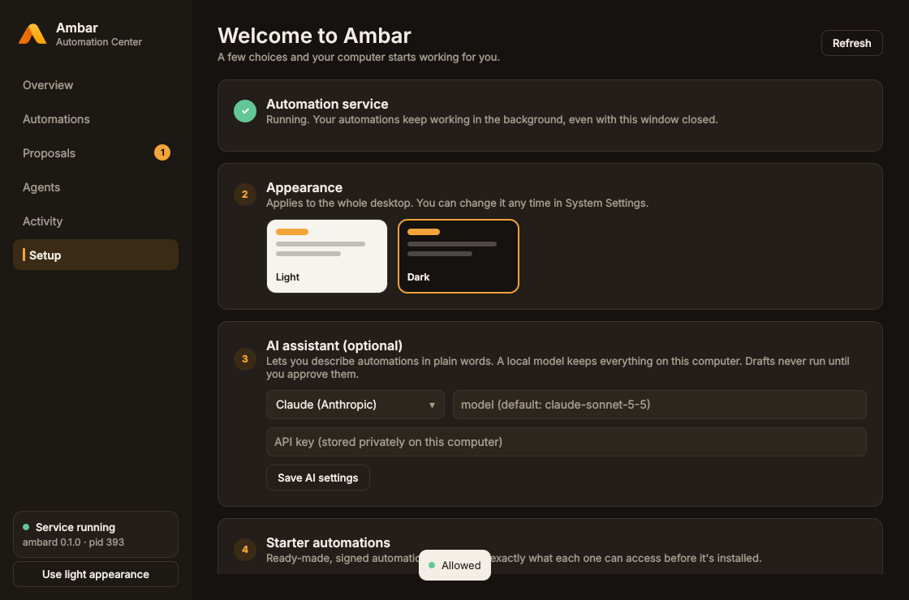
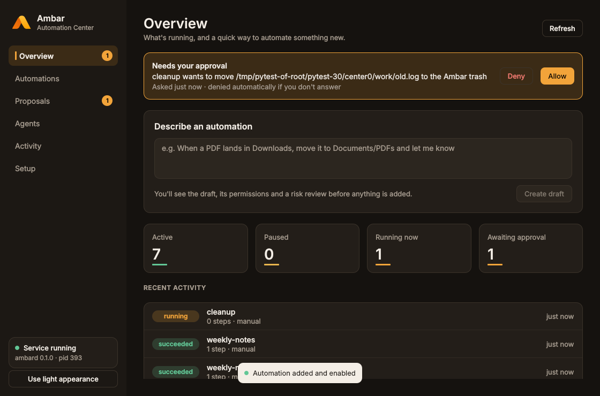

<p align="center"></p>

# Ambar OS

**Designed for Humans. Built for AI. Open to Everyone.**

Ambar OS is an AI-native, Linux-based operating system: the simplicity of macOS,
the openness of Linux, and automation built in from the start. See
[`docs/MASTER_PLAN.md`](docs/MASTER_PLAN.md) for the full vision and phases.

**Documentation:** [alexbieber.github.io/AmbarOS](https://alexbieber.github.io/AmbarOS/), built from [`docs/`](docs/index.md):

- [Try it from a USB stick](docs/live-usb.md)
- [Install](docs/install.md)
- [First steps](docs/first-steps.md)
- [Hardware](docs/hardware.md)
- [Troubleshooting](docs/troubleshooting.md)
- [FAQ](docs/faq.md)

## Status

The full Ambar software stack is built and tested: automation engine, background service with live approvals, AI automation builder, agent runtime, Automation Center desktop app (with first-run Welcome), KRunner search, Plasma theme, SDK, packages and marketplace. **The bootable OS images are written but have not been built or booted yet.** These are:

- an x86_64 and ARM64 install image
- a live USB with a built-in installer
- a Raspberry Pi 4 image

Building and booting them happens in CI (`os-image` workflow). Everything has been tested on Linux; macOS is untested.

185 automated tests pass, plus ~30,000 property-test cases. See [`docs/STATUS.md`](docs/STATUS.md) for exactly what is proven, what isn't, and the risks.



| First-run Welcome | Live approval |
|---|---|
|  |  |

## What's here

| Part | Where | Docs |
|---|---|---|
| Automation engine (workflows, triggers, permission-checked actions, history) | `crates/ambar-automation` | [architecture](docs/architecture.md), [workflow format](docs/workflow-format.md) |
| `ambard` background service, authenticated local IPC, agents | `crates/ambar-service` | [service](docs/service.md) |
| AI automation builder (Claude, OpenAI-compatible, Ollama) | `crates/ambar-ai`, `ambar ai` | below |
| Signed workflow packages + marketplace | `crates/ambar-pkg`, `marketplace/` | [developer guide](docs/developer-guide.md) |
| `ambar` CLI and `ambard` binaries | `crates/ambar-cli` | `ambar --help` |
| Automation Center (Qt/QML desktop app) | `desktop/automation-center` | |
| Ambar Plasma theme (colours, look-and-feel, wallpaper) | `desktop/plasma` | |
| Python SDK (owners and agents) | `sdk/python` | [developer guide](docs/developer-guide.md) |
| Bootable OS image (bootc, Fedora 45 Kinoite), x86_64 + ARM64 | `os/` | [OS image](docs/os-image.md) |
| Live USB with installer, Raspberry Pi image | `os/live/`, `os/rpi-firmware.sh` | [live USB](docs/live-usb.md), [install](docs/install.md) |
| Hardware report tool and compatibility list | `ambar-hwreport` | [hardware](docs/hardware.md) |
| Docs site, contributing, security policy | `docs/`, `mkdocs.yml`, root `*.md` | [community](docs/community.md) |

## Quick start

Requires Rust 1.89+.

```sh
cargo build --release
export PATH="$PWD/target/release:$PATH"

ambar validate examples/organize-downloads.toml

# Background service
ambar service start
ambar workflow add examples/organize-downloads.toml --enable   # asks before granting access
ambar workflow list
ambar service status
ambar history --steps
ambar audit
ambar service stop

# Start at login, so enabled workflows survive a reboot (launchd / systemd --user)
ambar service install

# Or run one workflow in the foreground, without the service
ambar run examples/daily-log.toml --once

# Describe an automation in plain words (needs a model: Claude, OpenAI-compatible, or local Ollama)
ambar ai config --provider anthropic        # key from $ANTHROPIC_API_KEY or `ambar ai set-key`
ambar ai create "when a PDF lands in Downloads, move it to Documents/PDFs and tell me"

# Give an assistant limited access
ambar agent create planner --scope read --scope propose
ambar agent proposals

# Packages
ambar pkg search notes --index marketplace/index.json

# Desktop app and theme
pip install ./sdk/python ./desktop/automation-center && ambar-center
desktop/install.sh                          # Plasma: Ambar look, wallpaper, launcher

# The OS image (Linux with rootful podman)
os/build.sh qcow2 && os/test-qemu.sh
os/build.sh live-iso                        # live USB: try without installing, install from it
```

A workflow looks like this:

```toml
id = "organize-downloads"
name = "Organize downloads"

[trigger]
type = "folder_watch"
path = "~/Downloads"

[[conditions]]
type = "file_extension"
any_of = ["pdf", "png", "jpg"]

[[actions]]
type = "move_file"
to_dir = "~/Documents/Ambar Inbox/{file_ext}/{date}"

[[actions]]
type = "notify"
title = "Filed {file_name}"

[permissions]
write = ["~/Downloads", "~/Documents/Ambar Inbox"]
notify = true
```

Full reference: [`docs/workflow-format.md`](docs/workflow-format.md).

## Security model (short version)

- Workflows **cannot run programs or shell commands**. The action set is closed.
- Nothing runs until the user **grants** the workflow's declared permissions.
- Every path is **resolved and re-checked at run time**, so symlinks or `..` can't escape the grant.
- **Trash and overwrite need explicit approval**. Trash is recoverable; nothing is unlinked.
- Grants are **re-read on every run**, so revoking one takes effect immediately.
- Every grant, state change and denial is written to an **audit log**.

Details: [`docs/architecture.md`](docs/architecture.md).

## Development

```sh
bash scripts/verify.sh            # everything below plus a live ambard smoke test
cargo fmt --all
cargo clippy --workspace --all-targets -- -D warnings
cargo test --workspace
python3 -m pytest sdk/python/tests desktop os/tests tests   # needs PySide6-Essentials, pytest, pyyaml
```

CI: `.github/workflows/ci.yml` runs Rust on Linux and macOS, the MSRV check, `cargo audit`, the Python and desktop tests (uploading screenshots), and the unit-file checks. `.github/workflows/os-image.yml` builds and boots the OS image.

## Contributing

See [CONTRIBUTING.md](CONTRIBUTING.md), the [Code of Conduct](CODE_OF_CONDUCT.md) and the [security policy](SECURITY.md). If you only have five minutes, [send a hardware report](docs/hardware.md#report-your-computer).

## License

[Apache-2.0](LICENSE).
