# Ambar's own tools

Tools written for Ambar OS, not taken from another distribution. Each one is a command you can script, plus an app in the Ambar style.

| Tool | Command | App | What it's for |
|---|---|---|---|
| **Ambar Recon** | `ambar-recon` | used by Workbench | Fast scanner: ports and services, web fingerprint, TLS, subdomains |
| **Ambar Workbench** | `ambar-engage` | Launchpad → Security | A security engagement from scope to report, with the OWASP testing checklist |
| **Practice labs** | `ambar-lab` | Workbench → Labs | OWASP Juice Shop and WebGoat, on this computer only |
| **Dependency-Check** | `ambar-depcheck` | Workbench → Labs | Known vulnerabilities in your own project's libraries (OWASP) |
| **Ambar Guard** | `ambar-guard` | Launchpad → System | Check and fix this computer's security; see which apps use the network |
| **Ambar Clean** | `ambar-clean` | Launchpad → Utilities | Free disk space safely |
| **Ambar Share** | `ambar-share` | Launchpad → Internet | Send files to a phone or computer on the same Wi-Fi |

All five apps share one design with the Automation Center: a sidebar, large page titles, white cards, colour-coded badges and the Inter font. They follow the system's light or dark setting.

!!! warning "Scope comes first"
    Recon and Workbench only touch targets in an **engagement scope** you write down, and refuse everything else. Without a scope they only scan your own computer. Only test systems you own or have written permission to test.

## The scope file

Every Ambar security tool reads the same `scope.toml`, and applies exactly the same rules (one implementation, in Rust):

```toml
[engagement]
name = "ACME external test"
authorised_by = "Jane Doe, CISO, signed 2026-11-10"
starts = 2026-11-12
ends = 2026-11-30

[scope]
include = ["203.0.113.0/24", "acme.example", "*.acme.example"]
exclude = ["203.0.113.1", "vpn.acme.example"]
```

- A target must match an `include` entry and no `exclude` entry, and today must be inside the dates.
- `*.acme.example` covers `www.acme.example` and deeper names, but not `acme.example` itself, and never `evilacme.example`.
- A host name in scope that **resolves** to an excluded address is refused.
- A web page that **redirects** out of scope is reported, not followed further.
- Every scan is logged in `activity.log` next to the scope file.

## Ambar Recon

```sh
ambar-recon ports localhost                         # your own computer: no scope needed
ambar-recon --scope scope.toml ports 203.0.113.0 -p top
ambar-recon --scope scope.toml ports www.acme.example -p 1-1024 --concurrency 512
ambar-recon --scope scope.toml http https://www.acme.example
ambar-recon --scope scope.toml tls www.acme.example:443
ambar-recon --scope scope.toml subdomains acme.example
ambar-recon --scope scope.toml scope 203.0.113.1    # would this be allowed? (touches nothing)
```

Add `--json` for one JSON object per line. `AMBAR_SCOPE=path` saves typing `--scope`.

| Command | What it finds |
|---|---|
| `ports` | Open TCP ports (nmap's top 100 plus common modern services, or any list or range), the service on each from what it says (SSH, HTTP, SMTP, FTP, Redis, MySQL, VNC…). It's a full connect scan, so it needs no root. |
| `http` | Status, page title, server, technologies (nginx, Apache, IIS, PHP, WordPress, Next.js, React, Cloudflare and more), missing security headers, cookies without `HttpOnly`/`Secure` |
| `tls` | TLS version and cipher, certificate subject, issuer, names, expiry, whether this computer would trust it, self-signed and short-expiry warnings |
| `subdomains` | Names from certificate-transparency logs (no packets to the target) plus DNS guesses from a built-in list or yours (`--wordlist`); wildcard DNS is detected |

## Ambar Workbench

An engagement is a folder, `~/Engagements/<name>`, holding the scope, every run's output, the findings and the report.

```sh
ambar-engage new "ACME external" --include 203.0.113.0/24 "*.acme.example" \
    --exclude 203.0.113.1 --authorised-by "Jane Doe, CISO, letter 2026-11-10" --ends 2026-11-30
ambar-engage run recon-ports 203.0.113.10
ambar-engage run recon-http https://shop.acme.example
ambar-engage run nmap 203.0.113.10 -- -p- -T4
ambar-engage run nuclei https://shop.acme.example
ambar-engage findings --add "Default admin password" --severity high --target 203.0.113.10 --detail "admin/admin works"
ambar-engage findings
ambar-engage report --format pdf            # also md and html
```

- Every `run` checks its target against the scope first. A refused target is logged, and nothing runs.
- Output from **ambar-recon, nmap and nuclei** becomes findings automatically, with a severity. For example, an exposed Docker API is high and an exposed Redis is medium. Running the same scan again doesn't duplicate them.
- Output of any other tool (ffuf, nikto, testssl, sslscan, whatweb…) is kept in `runs/`.
- The **report** lists the engagement, who authorised it, the scope, findings by severity with details, and the activity log.

The **Workbench app** does the same in a window: engagements in the sidebar, and Scope, Run, Findings and Report pages.

=== "Light"

    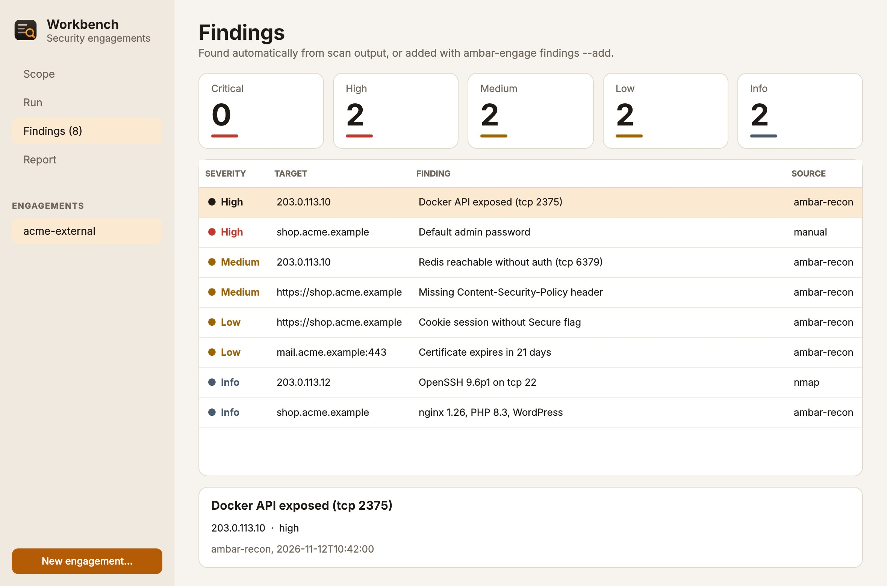

=== "Dark"

    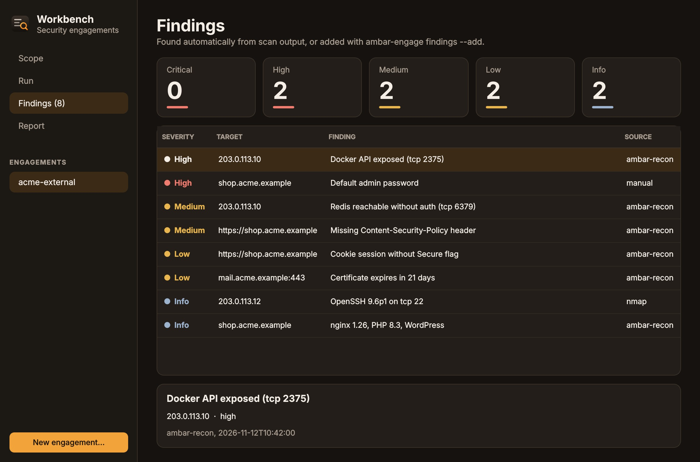

### OWASP testing checklist

Every engagement carries the [OWASP Web Security Testing Guide](https://owasp.org/www-project-web-security-testing-guide/) checklist: 109 tests in 12 areas, from information gathering to API testing. Mark each test as passed, issue found or not applicable, with a note. A finding linked to a test marks it as an issue, and the report gets a coverage section.

```sh
ambar-engage checklist                                   # every test, with its status
ambar-engage checklist --category INPV                   # one area
ambar-engage checklist WSTG-CONF-07 --status pass
ambar-engage checklist WSTG-CONF-11 --status na --note "no cloud storage"
ambar-engage findings --add "Order total can be changed" --severity high --target 203.0.113.10 --wstg WSTG-BUSL-01
```

The **Checklist** page in the Workbench does the same, with coverage per area.

=== "Light"

    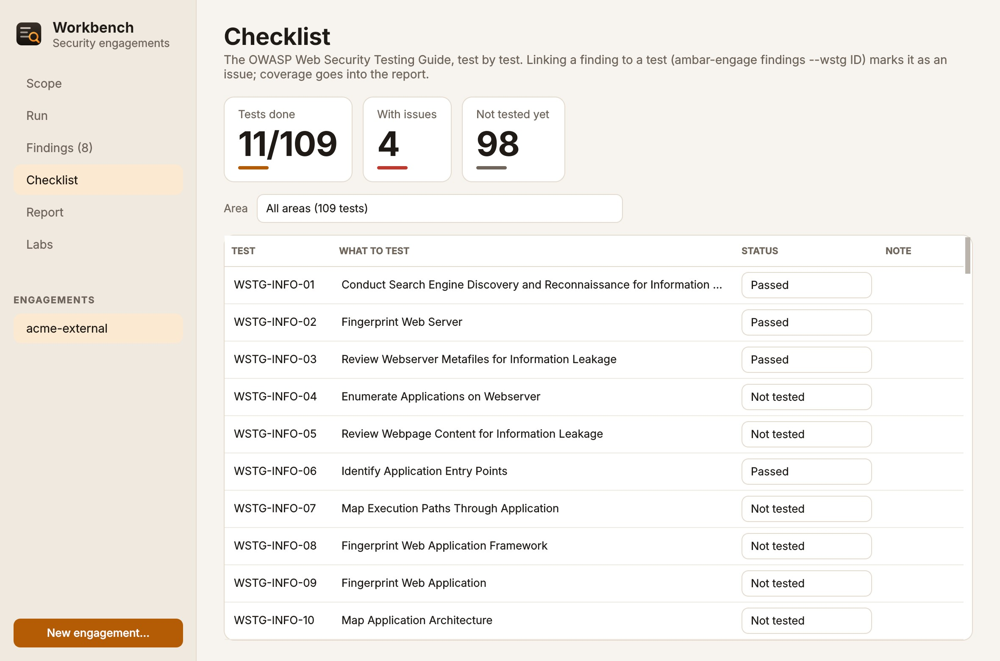

=== "Dark"

    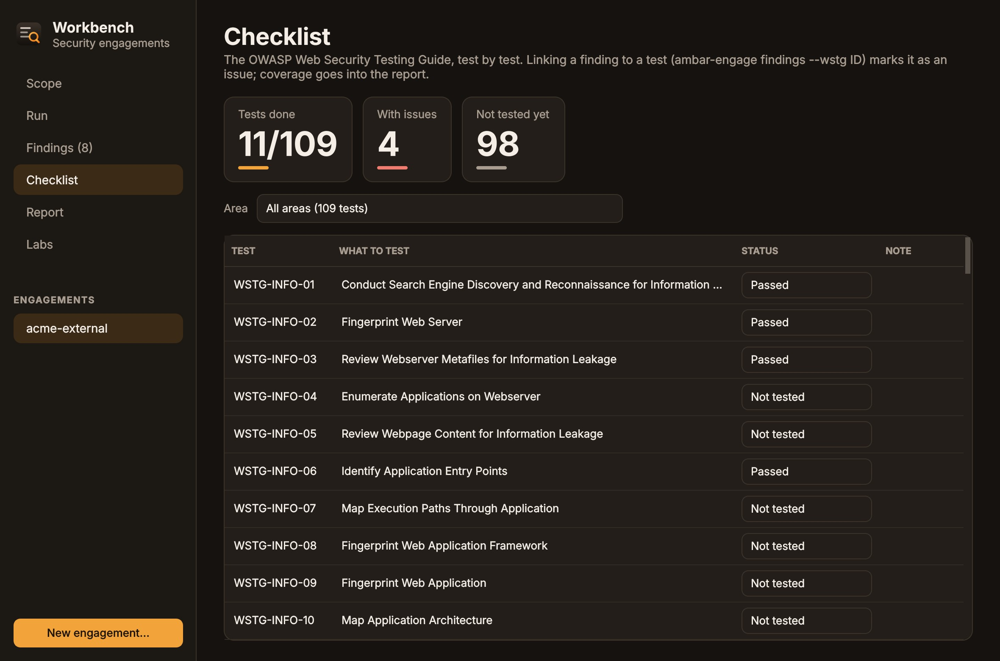

## Practice labs

Learn on deliberately vulnerable apps made by OWASP, on your own computer, before you test anything real. Each lab runs in a container that listens on 127.0.0.1 only, so nothing on your network can reach it.

```sh
ambar-lab list
ambar-lab start juice-shop      # OWASP Juice Shop: http://127.0.0.1:3000/
ambar-lab start webgoat         # OWASP WebGoat: http://127.0.0.1:8080/WebGoat/ (WebWolf on 9090)
ambar-lab stop juice-shop
```

The first start downloads the lab, which takes a few minutes. Testing your own computer needs no scope, so Workbench and Ambar Recon work on the labs straight away. The **Labs** page in the Workbench starts, stops and opens them.

## Check your own code: OWASP Dependency-Check

```sh
ambar-depcheck ~/code/my-app              # HTML report in ~/code/my-app/dependency-check-report/
NVD_API_KEY=… ambar-depcheck ~/code/my-app # much faster first run (free key from nvd.nist.gov)
```

It finds known vulnerabilities in the libraries your project uses (npm, Maven, Gradle, Python, .NET, Ruby, Go and more). The project folder is mounted read-only, and the vulnerability database is cached in `~/.cache/ambar/dependency-check`.

=== "Light"

    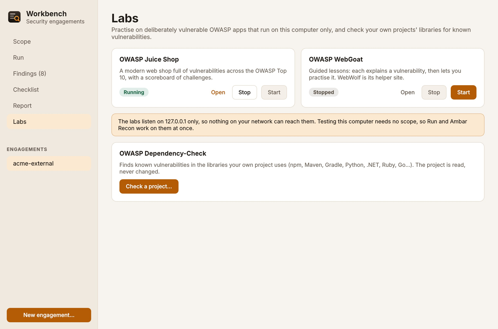

=== "Dark"

    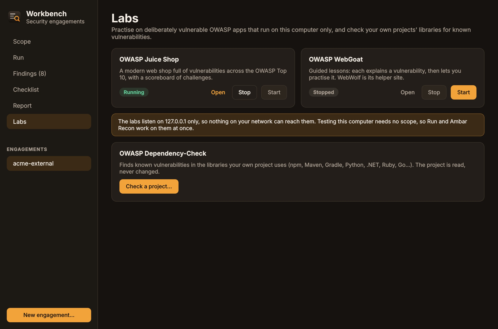

## Ambar Guard

```sh
ambar-guard check            # every check and a score out of 100
ambar-guard fix firewall ssh # fix specific checks (asks for your password)
ambar-guard fix --all        # every failed check that can be fixed
ambar-guard fix --all --dry-run
ambar-guard net              # which apps are talking to which addresses
ambar-guard net --listening  # what can be reached from the network
```

| Check | Fix |
|---|---|
| Firewall is on | blocks incoming, allows outgoing |
| No unexpected services listen on the network | you decide what to stop |
| SSH: no root login, no password login | keys only |
| No security updates waiting | installs them |
| Security updates install automatically | turns on unattended-upgrades |
| System disk is encrypted | advice only: choose encryption when installing |
| Screen locks automatically | turns locking on |
| No program folder writable by everyone | removes the write permission |
| sudo always asks for a password | advice: which rule to remove |
| Kernel hardening (kptr, dmesg, ptrace) | sets them |
| Secure Boot | advice: firmware setting |

Each fix says what it does before it runs, and changes nothing else. Connections are read straight from the kernel (`/proc`), so `net` works without extra tools. Seeing other users' processes needs `sudo`.

=== "Light"

    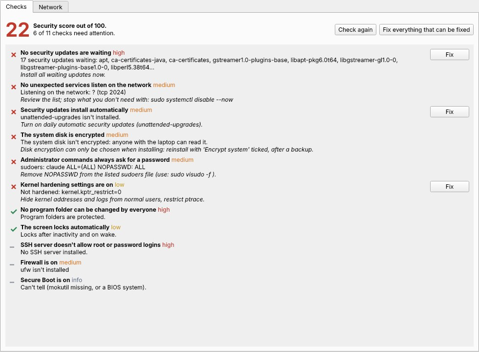

=== "Dark"

    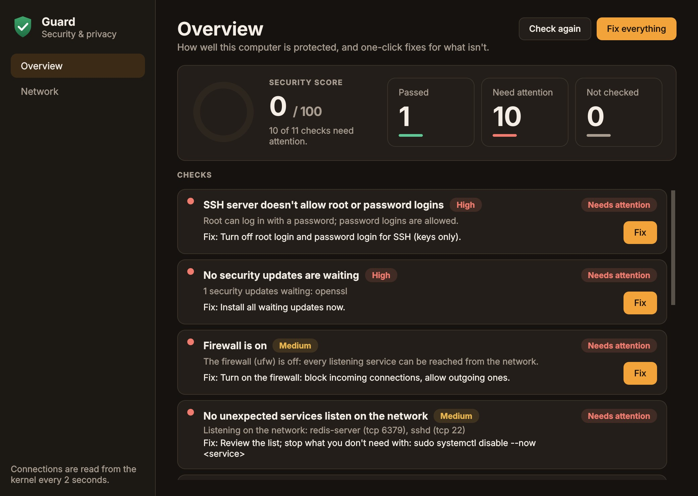

## Ambar Clean

```sh
ambar-clean                  # what can be freed
ambar-clean run              # the safe clean
ambar-clean run trash --yes  # empty the Trash too (permanent)
```

The safe clean removes only things that are rebuilt or re-downloaded when needed:

- app caches: thumbnails, shader, pip, npm, Go and Cargo
- downloaded package files
- logs older than two weeks
- packages nothing uses
- unused Flatpak runtimes and old Snap versions
- crash reports

It never follows a symbolic link out of a cache folder, and never touches folders it doesn't know.

=== "Light"

    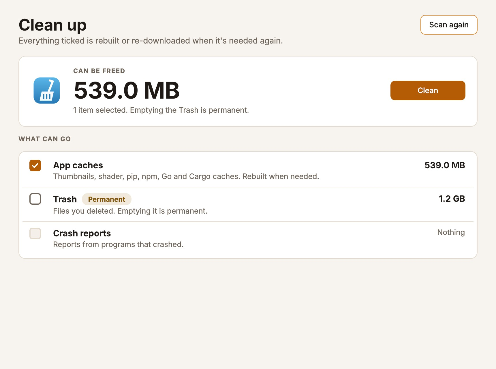

=== "Dark"

    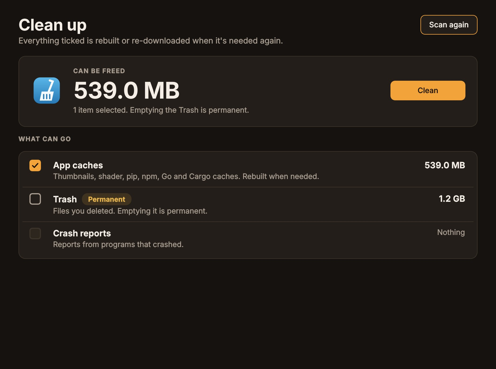

## Ambar Share

```sh
ambar-share holiday.jpg report.pdf            # link + QR code, for 30 minutes
ambar-share video.mp4 --once                  # stops after it's downloaded
```

The link holds 128 random bits, so it can't be guessed. Only the files you named are served. The link stops working when time is up, or after the download with `--once`. Each download is shown with the address that fetched it. Files go directly between the two devices; nothing goes through the internet.

If **Ambar Guard** turned the firewall on, other devices can't reach the share until you allow it: `sudo ufw allow from 192.168.0.0/16 to any port <port>` (the port is in the link).

=== "Light"

    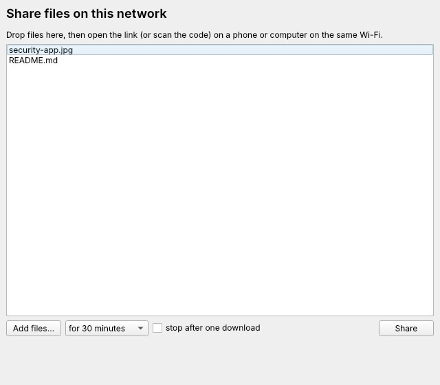

=== "Dark"

    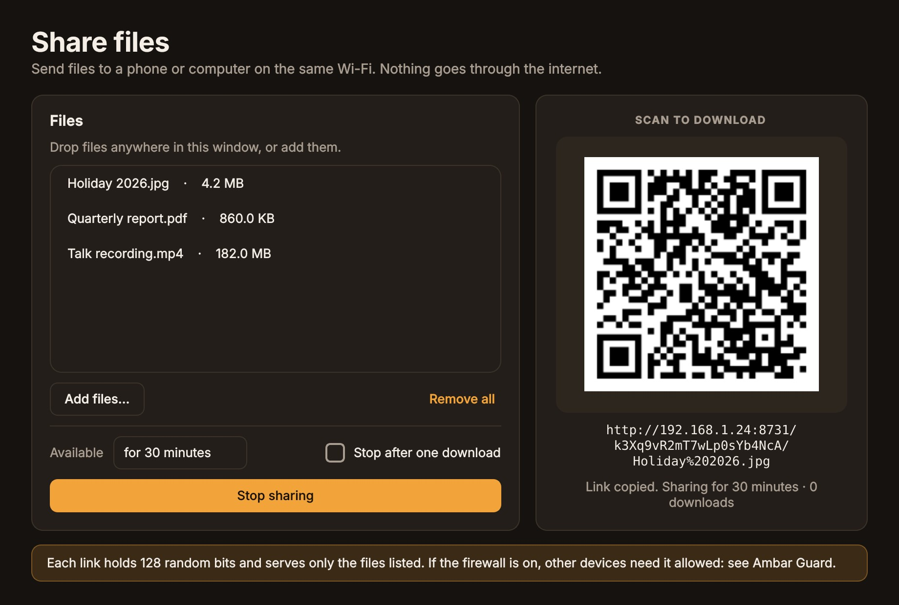
