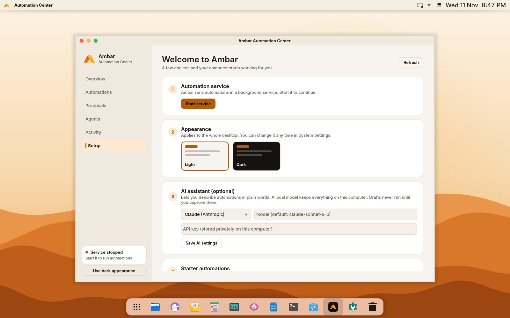

# First steps

A tour of the desktop, how to install apps, and your first automation.

## Your desktop



| macOS | Ambar OS | How |
|---|---|---|
| Apple menu | **Ambar menu**: the logo at the top left | About This Computer, Settings, Store, Force Quit, Sleep, Restart, Shut Down, Lock |
| Menu bar | **Menu bar**: the name and menus of the app in front | Apps put their File, Edit, View… menus here |
| Control Center | **Control Center**: the toggle icon next to the clock | Wi-Fi, Bluetooth, Airplane Mode, Do Not Disturb, Dark Mode, Night Light, display brightness, sound |
| Spotlight | **Search** | **Meta+Space** (or Alt+Space): apps, files, settings, calculations, automations |
| Dock | **Dock** at the bottom | Click to open; running apps sit on a soft highlight, the one in front a stronger one; right-click to pin |
| Launchpad | **Launchpad**: the grid icon at the left of the Dock | Every app A–Z on pages: swipe, scroll or use the arrow keys; start typing to search, Enter opens the first result, Escape closes |
| Mission Control | **Overview** | **Meta+W**, or a four-finger swipe up on a touchpad |
| Finder | **Files** (Dolphin) | Tabs, split view, previews, network places |
| Window buttons | Red, yellow, green circles on the left | Close, minimise, maximise |
| Force Quit | Ambar menu → Force Quit, or **Ctrl+Alt+Esc** | Click the window to close |
| Screenshot | **Print Screen**, or Control Center → Screenshot | Area, window or full screen |
| Lock screen | **Meta+L** | |

Light or dark: Control Center → **Dark Mode** switches the whole desktop, including colours, icons, window frames and the wallpaper.

## Install apps

Ambar OS installs software in every common Linux format, so most apps you'd want are a click away:

| What | How |
|---|---|
| **Ambar Store** (Dock) | Search, then click Install. Covers Ubuntu's apps, Flathub and Snap. |
| A `.deb` from a website (Chrome, VS Code, Zoom, Discord, Steam…) | Download it and double-click. The Store installs it and keeps it updated if the app adds its own repository. |
| Flatpak | Flathub is built in: `flatpak install flathub <app>`, or use the Store. |
| Snap | `sudo snap install <app>`, or use the Store. |
| AppImage | Download, then right-click → Properties → Permissions → *Is executable*, and double-click. |
| Windows programs | `.exe` and `.msi` files open with **Wine** (installed). For games and tricky apps, install **Bottles** from the Store. |
| Terminal | `sudo apt install <package>`; `distrobox` for apps from other Linux distributions. |

Drivers: **Driver Manager** (in Launchpad) offers NVIDIA and other vendor drivers when your hardware needs them.

## Ambar automation

### 1. The Welcome setup

The first time you log in, **Welcome to Ambar** opens. It has five steps:

1. **Automation service:** it checks that `ambard` (the service that runs automations) is running. It starts with your session, so this is usually already green.
2. **Appearance:** Light or Dark. This applies to the whole desktop.
3. **AI assistant (optional):** choose Claude, an OpenAI-compatible service, or a local Ollama model, and enter an API key if it needs one. You can skip this; everything else works without AI.
4. **Starter automations:** signed, ready-made automations. Each one shows exactly what it can access before you install it.
5. **Recommended apps (optional):** tick apps that can't come preinstalled, such as Chrome, VS Code, Spotify, Zoom, Steam and Thunderbird. They're installed from Flathub in a terminal window, so you see every step. Remove them any time in the Ambar Store.

You can come back to it from the **Setup** page in the Automation Center.

### 2. The Automation Center

Open **Automation Center** from the launcher. Its pages:

| Page | What it's for |
|---|---|
| Overview | What's running, what's waiting, and a box to describe a new automation |
| Automations | Turn automations on and off, pause them, run them now, remove them |
| Proposals | Automations suggested by agents or the AI, waiting for your decision |
| Agents | Assistants that have limited access to Ambar |
| Activity | Every run, step by step |
| Setup | The Welcome steps again |

### 3. Make your first automation

#### With AI

On **Overview**, type what you want, for example:

> When a PDF lands in Downloads, move it to Documents/PDFs and tell me

Then choose **Create draft**. Before anything is added, you see three things:

- the automation itself
- the folders it needs
- a **risk review**

Approve it, and it's added and switched on.

#### By hand

Save this as `tidy-screenshots.toml`:

```toml
id = "tidy-screenshots"
name = "Tidy screenshots"

[trigger]
type = "folder_watch"
path = "~/Pictures/Screenshots"

[[conditions]]
type = "file_extension"
any_of = ["png"]

[[actions]]
type = "move_file"
to_dir = "~/Pictures/Screenshots/{date}"

[permissions]
write = ["~/Pictures/Screenshots"]
```

Then:

```sh
ambar validate tidy-screenshots.toml          # check it, and see what access it needs
ambar workflow add tidy-screenshots.toml --enable
```

All triggers, conditions and actions are in the [workflow format](workflow-format.md).

### 4. Search for automations

Press **Meta+Space** (or Alt+Space) and type:

| Type | What happens |
|---|---|
| the name of an automation | run it now, or open it in the Automation Center |
| `automate` followed by a description | opens a new AI draft |
| `approvals` | shows how many actions are waiting for your decision |

### 5. Approvals

Moving files to the trash and overwriting files are sensitive. Unless you allowed them when you granted the automation its access, they need your decision each time. When one comes up, a notification appears. You can answer it in any of three places:

- the Automation Center
- KRunner
- a terminal:

```sh
ambar approval list
ambar approval allow <id>
ambar approval deny <id>
```

If nobody answers within 5 minutes, the action is **denied**.

### 6. See what happened

```sh
ambar service status          # is the service healthy?
ambar workflow list           # your automations and their state
ambar history --steps         # recent runs, step by step
ambar audit                   # every grant, change and refusal
```

Next: [Troubleshooting](troubleshooting.md) if something doesn't work, or the [Developer guide](developer-guide.md) to build agents and packages.
