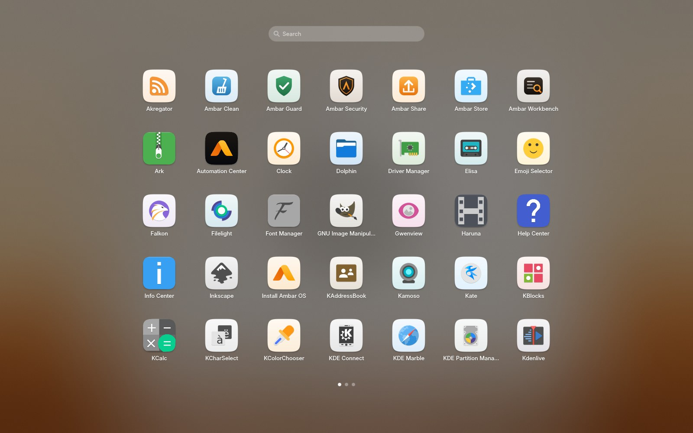
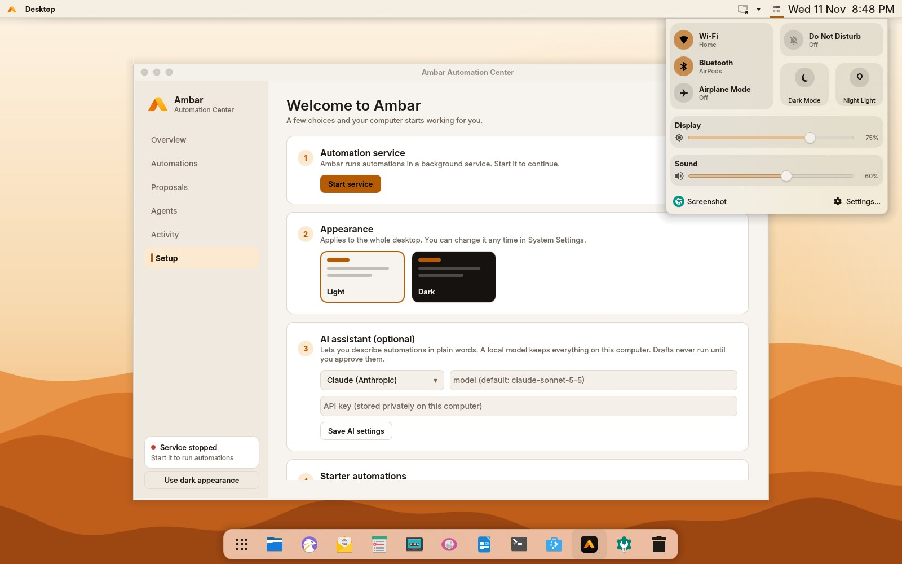
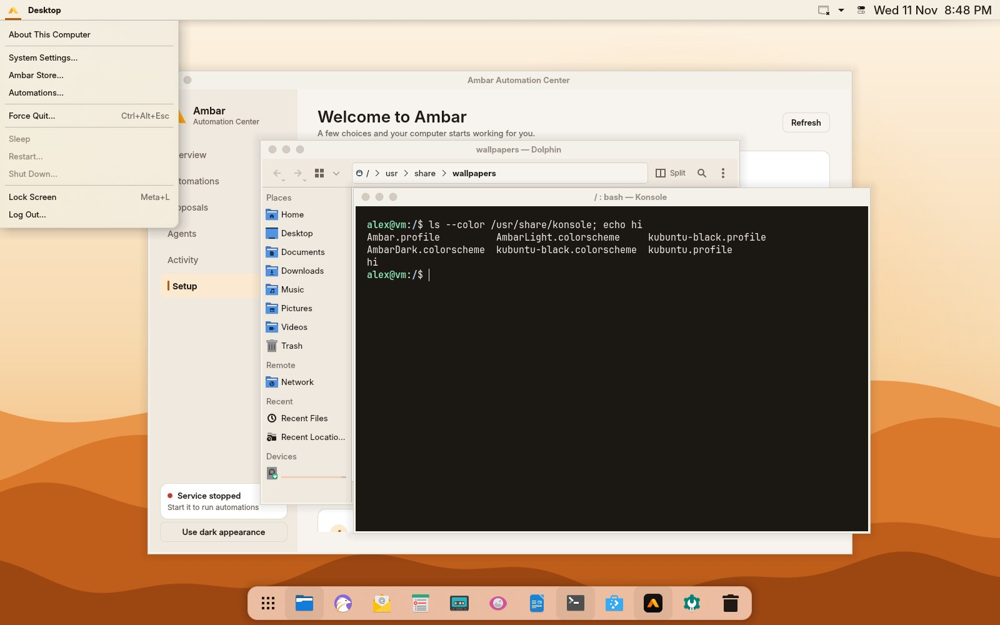
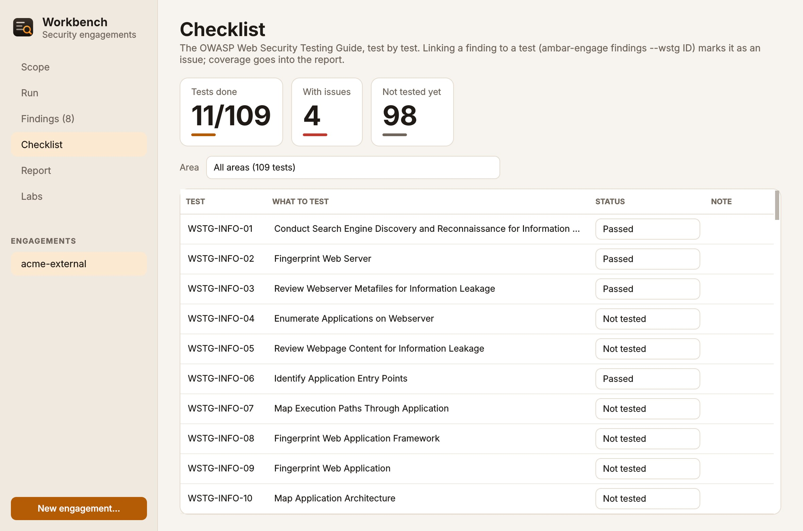
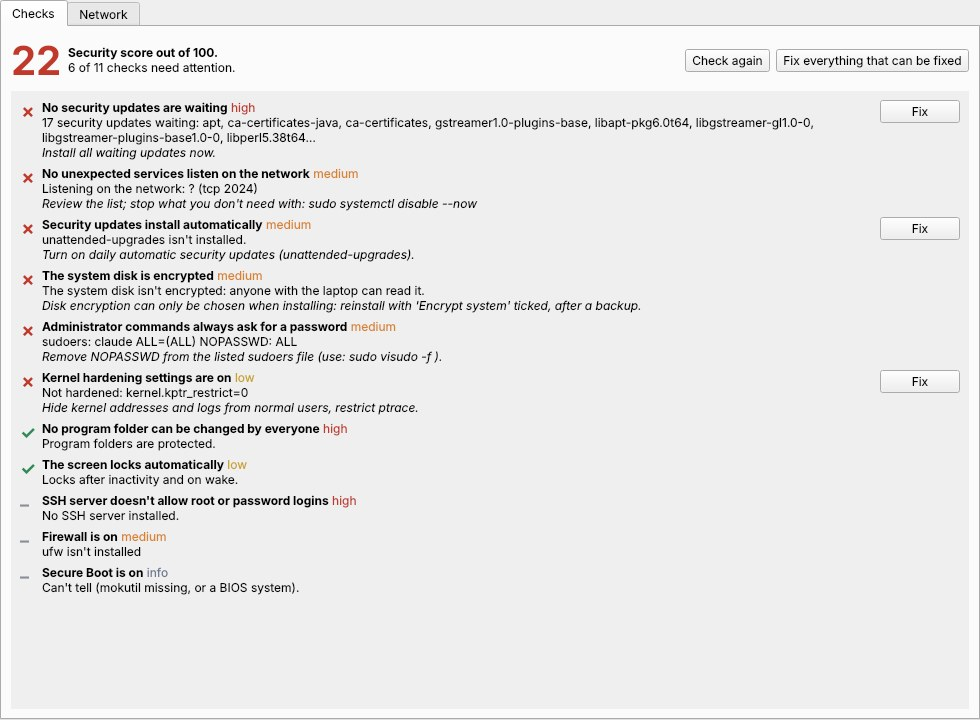
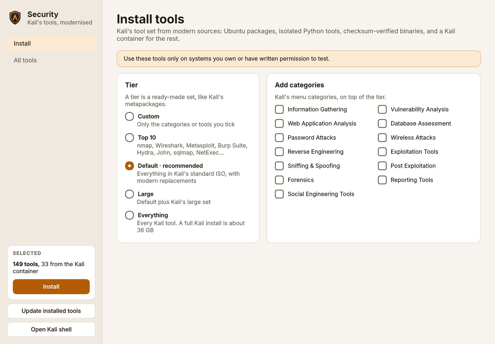

# Ambar OS { .ambar-hero__title }

Designed for Humans. Built for AI. Open to Everyone.

A complete desktop operating system on Ubuntu 26.04 LTS and KDE Plasma 6. It looks and works like macOS, runs the apps you need on day one, and adds safe automations and a full security toolkit.

[Try it from a USB stick](live-usb.md){ .md-button .md-button--primary }
[First steps](first-steps.md){ .md-button }
[View on GitHub :material-github:](https://github.com/alexbieber/AmbarOS){ .md-button }

Free and open source · Apache-2.0 · Version 0.2

<figure class="ambar-shot ambar-shot--hero" markdown>

</figure>

Early project: everything shown here runs in the real system and is tested, but it has only been booted in virtual machines so far. <a href="STATUS/">See exactly what's proven</a>.

## What you get { .ambar-section }

### :material-apple-finder: Feels like a Mac
A menu bar with app menus, a frosted Dock, Launchpad, Control Center, Spotlight-style search, traffic-light windows, one icon shape for every app, and light and dark modes.

[First steps →](first-steps.md)

### :material-apps: Ready on day one
Office, mail, calendar, notes, photo and video editing, design, music, video, weather, maps, backups and games, all installed. Pick Chrome, VS Code, Spotify or Zoom on first login.

[Install →](install.md)

### :material-package-variant-closed: Install anything
The Ambar Store covers Ubuntu, Flathub and Snap. Double-click a `.deb`, an AppImage, or a Windows `.exe`, and other Linux distributions run in containers.

[FAQ →](faq.md)

### :material-robot-happy-outline: Automations that can't hurt you
Small TOML files watch folders and run on schedules. They can never run programs, only touch folders you grant, and log everything. AI can draft them; you approve.

[Workflow format →](workflow-format.md)

### :material-shield-search: A security workbench
Kali's tool set from modern sources, Ambar's own scanner, and engagements with a scope that every tool checks. Includes the OWASP testing checklist, practice labs and reports.

[Security tools →](security.md)

### :material-shield-check: Protected by default
Ambar Guard checks your firewall, updates, SSH, disk encryption and more, fixes what it can in one click, and shows which apps talk to the network.

[Ambar's own tools →](ambar-tools.md)

## See it { .ambar-section }

<figure markdown>

<figcaption>Launchpad: every app, one tile shape, type to search</figcaption>
</figure>

<figure markdown>

<figcaption>Control Center: Wi-Fi, Bluetooth, Focus, display and sound</figcaption>
</figure>

<figure markdown>

<figcaption>The Ambar menu, Files and the Ambar terminal</figcaption>
</figure>

<figure markdown>

<figcaption>Workbench: the OWASP testing checklist, test by test</figcaption>
</figure>

<figure markdown>

<figcaption>Ambar Guard: a security score and one-click fixes</figcaption>
</figure>

<figure markdown>

<figcaption>Ambar Security: install Kali's tools by tier or category</figcaption>
</figure>

## Two editions { .ambar-section }

### Ambar OS
For everyone. The full desktop, the day-one apps and automations. The security tools are one click away in the Ambar Security app when you need them.

`ambar-os-0.2-amd64.iso`

### Ambar OS Security
For security professionals and learners. Everything in Ambar OS, plus Kali's default tool set preinstalled and a first-run guide.

`ambar-os-security-0.2-amd64.iso`

## Start here { .ambar-section }

| I want to… | Go to |
|---|---|
| Try it without installing anything | [Try it from a USB stick](live-usb.md) |
| Install it next to Windows, or on its own | [Install](install.md) |
| Learn the basics in 10 minutes | [First steps](first-steps.md) |
| Check whether my computer works | [Hardware](hardware.md) |
| Fix a problem | [Troubleshooting](troubleshooting.md) |
| Write automations by hand | [Workflow format](workflow-format.md) |
| Build agents, packages or the OS itself | [Developer guide](developer-guide.md) |
| Help out | [Community](community.md) |

## See automations in action { .ambar-section }

<video controls preload="metadata" poster="media/ambar-demo-poster.jpg" class="ambar-video">
  <source src="media/ambar-demo.mp4" type="video/mp4">
</video>

<small>A one-minute recording of the real Automation Center and `ambard`. The AI reply is replayed from a file, so the demo needs no API key.</small>
