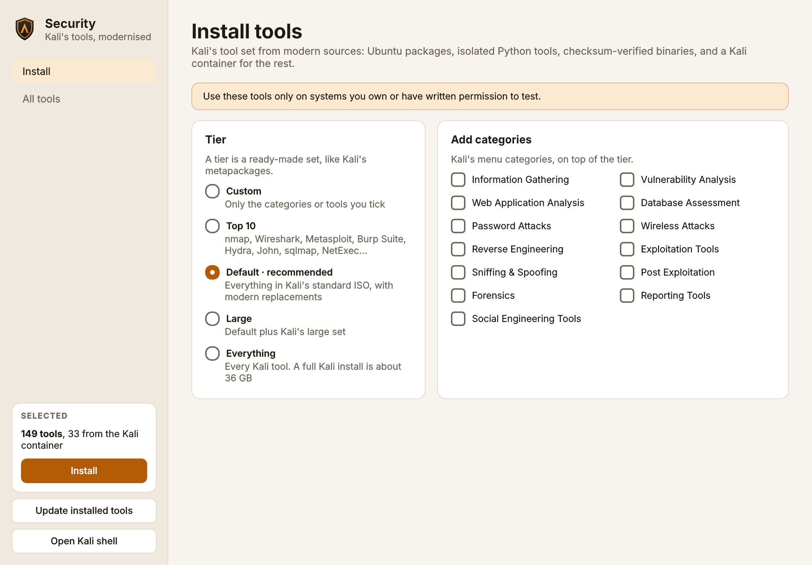
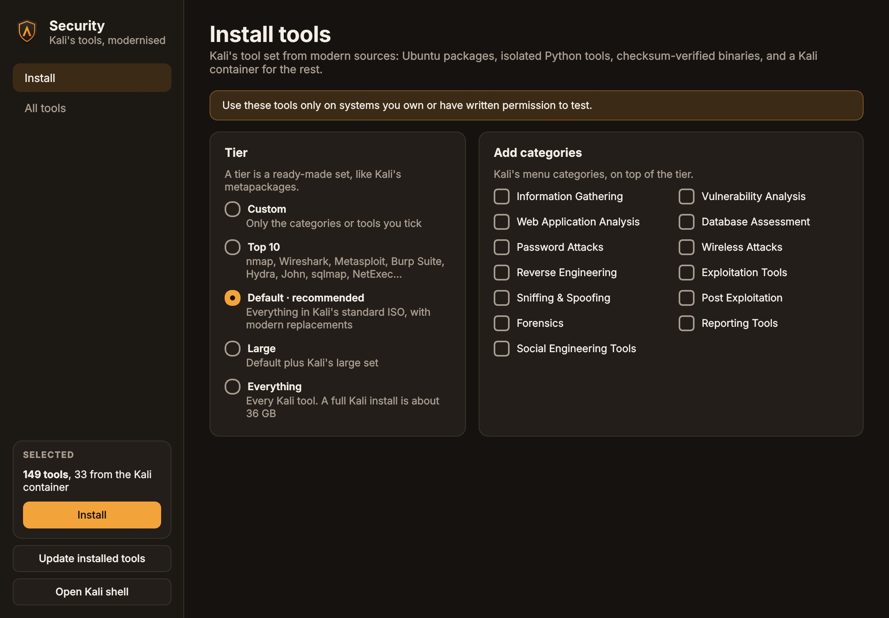

# Security tools

Ambar OS can install **Kali Linux's tool set**: every tool in Kali's default ISO, and with one more click, everything Kali has. Ambar uses Kali's own tiers and menu categories, but takes each tool from the most modern source it can, so the tools stay current and can't break the system.

!!! warning "Only test what you're allowed to test"
    Use these tools only on systems you own or have **written permission** to test. Scanning or attacking other people's systems is illegal in most countries.

## Two ways to get them

| | What you get |
|---|---|
| **Ambar OS Security** (separate ISO) | The whole Default tier preinstalled. On first login, the **Ambar Security** app offers to add the Kali-container tools (Metasploit, Burp Suite and the rest). |
| **Ambar OS** (the normal ISO) | Nothing preinstalled. Add any tier, category or single tool whenever you like with the **Ambar Security** app or `ambar-sec`. |

This mirrors Kali, whose normal image ships its *default* metapackage and lets you add *large* or *everything* later.

## The Ambar Security app

Open **Launchpad → Security → Ambar Security** (or search for "Security").

=== "Light"

    

=== "Dark"

    

1. Pick a **tier**: Top 10, Default (recommended), Large or Everything.
2. Tick extra **categories**, or single tools on the **All tools** page.
3. Click **Install**. A terminal window shows every step, and asks for your password for the system part.

Installed tools appear in **Launchpad → Security**, sorted into Kali's categories: Information Gathering, Vulnerability Analysis, Web, Database, Passwords, Wireless, Reverse Engineering, Exploitation, Sniffing & Spoofing, Post Exploitation, Forensics, Reporting and Social Engineering. Command-line tools open a terminal showing their help, like Kali's menu.

## From the terminal: `ambar-sec`

```sh
ambar-sec list                       # every tool, ✓ = installed
ambar-sec list --category web        # one category
ambar-sec info netexec               # where it comes from, what it replaces
ambar-sec install default            # Kali's default set (the Security ISO already has it)
ambar-sec install wireless           # one category
ambar-sec install nuclei ffuf        # single tools
ambar-sec install everything         # every Kali tool (Kali: about 36 GB)
ambar-sec update                     # update everything installed, from every source
ambar-sec status                     # what's installed, binary versions and checksums
ambar-sec shell                      # a shell inside the Kali container
ambar-sec remove nuclei
```

Add `--dry-run` to any install to see exactly what would run.

## Tiers

| Tier | Same as Kali's | What's in it |
|---|---|---|
| `top10` | `kali-tools-top10` | nmap, Wireshark, Aircrack-ng, Hydra, John, sqlmap, NetExec, Metasploit, Burp Suite, Responder |
| `default` | `kali-linux-default` | All of Kali's default ISO (204 packages, each covered), plus modern tools |
| `large` | `kali-linux-large` | Default, plus Kali's large set inside the Kali container |
| `everything` | `kali-linux-everything` | Default, plus every Kali tool inside the Kali container |

## Where each tool comes from, and why

Kali installs everything as packages into one system. Many of its tools are old, and some (Ruby, Java, old Python) pull in dependencies that clash. Ambar picks a source per tool:

| Source | Used for | Why |
|---|---|---|
| **Ubuntu packages** | ~150 tools Ubuntu maintains: nmap, Wireshark, hashcat, John, Hydra, sqlmap, ffuf, gobuster, bettercap, hcxtools, gitleaks, testssl.sh, radare2, Autopsy… | Security updates arrive with normal system updates |
| **Python tools in their own environment** (pipx) | NetExec, Certipy, Impacket, BloodHound CE collector, bloodyAD, enum4linux-ng, theHarvester, sslyze, Volatility 3… | Each tool gets its own environment, so tools can't break each other or the system |
| **Release binaries, checksum-verified** | nuclei, httpx, subfinder, naabu, katana, dnsx, trufflehog, chisel | Straight from the developers' latest release. Installed **only if the SHA-256 matches** the checksums the release publishes; otherwise refused |
| **Kali container** (distrobox) | Metasploit, Burp Suite, Responder, WPScan, SET, Empire, ZAP, Ghidra, Kismet, BloodHound, ropper, pdfid, wordlists and SecLists, and the Large/Everything tiers | The real Kali rolling packages, always current, isolated from your system. Their commands and apps still appear in your menu and terminal |

### Modern replacements

Where Kali still ships an old tool, Ambar adds the maintained successor next to it:

| Older tool | Modern tool |
|---|---|
| CrackMapExec | **NetExec** (`nxc`) |
| enum4linux | **enum4linux-ng** |
| dirb, DirBuster | **ffuf**, **feroxbuster** |
| Sublist3r | **subfinder** |
| hash-identifier | **Name-That-Hash** (`nth`) |
| BloodHound (legacy) collector | **BloodHound CE** collector |
| Volatility 2 | **Volatility 3** |
| nikto for template checks | **nuclei** |
| nmap alone for big sweeps | **naabu**, **RustScan**, then nmap |

`ambar-sec list` marks these with *(replaces …)*.

## Safe defaults

- **Services stay off.** Kali's set includes servers (Apache, MySQL, Samba, SNMP, TFTP, INetSim…). Ambar installs them but leaves them **disabled**, as Kali does. Start one when you need it: `sudo systemctl start apache2`.
- **Verified downloads.** Release binaries are installed only when their checksum matches; the version and hash are recorded (`ambar-sec status`).
- **Isolation.** Kali packages live in the `ambar-kali` container, Python tools in their own environments.
- **Separate from automations.** Ambar's automations and AI assistant can't run any of these tools. Their action set stays closed.
- **A log** of what was installed: `~/.local/state/ambar/security.log` and `/var/lib/ambar-security/log`.

## Disk space

| What | Space |
|---|---|
| Default tier, Ubuntu packages and Python tools | about 5.5 GB, measured on a minimal Ubuntu 26.04 system; less on Ambar OS, which already has many of the libraries |
| Kali container with the Default tier's Kali tools | several GB (not measured yet) |
| `large`, `everything` | Kali's own figures: about 21 GB and 36 GB for a full Kali install |

## Troubleshooting

| Problem | Fix |
|---|---|
| A release binary "publishes no checksums" or "SHA-256 mismatch" | Ambar refused it on purpose. Try again later, or use the Kali version: `ambar-sec shell` then `sudo apt install <tool>` |
| GitHub rate limit when installing binaries | Set a token for this shell: `export GITHUB_TOKEN=…`, then run the install again |
| A Kali tool isn't found | `ambar-sec shell`, then run it there; or reinstall it so its command is exported: `ambar-sec install <tool>` |
| Wireshark can't capture without root | `sudo dpkg-reconfigure wireshark-common`, choose **Yes**, then `sudo usermod -aG wireshark $USER` and log in again |
